# The Journal API

Everything a journal script can call: each function, method and property, what it takes, and what it gives back, with short examples and what they draw. The showcase journal (`webapp/journals/showcase`) shows it all drawn at length.

- [Reading This](#reading-this)
- [The Entry and Its Pages](#the-entry-and-its-pages)
- [Canvases and Strokes](#canvases-and-strokes)
- [Vectors and Angles](#vectors-and-angles)
- [Paths](#paths)
- [Styles](#styles)
- [Gradients](#gradients)
- [Images](#images)
- [Glyphsets and Glyphs](#glyphsets-and-glyphs)
- [Text](#text)
- [Keeping Text Clear](#keeping-text-clear)
- [Randomness and Messages](#randomness-and-messages)
- [Generators](#generators)
- [Balanced Ternary](#balanced-ternary)
- [Procedural Art](#procedural-art)
- [Books](#books)
- [Page Layouts](#page-layouts)
- [Marked-Up Text](#marked-up-text)
- [Locks](#locks)
- [Value Kinds](#value-kinds)
- [Journals and Their Files](#journals-and-their-files)
- [Lock, Illustration, Layout and Style Files](#lock-illustration-layout-and-style-files)
- [The Library](#the-library)
- [Building](#building)

## Reading This

A journal is a directory of entries and the files they use (see Journals and Their Files). Each entry is a rhai script: it draws strokes onto canvases, puts canvases on pages, and adds the pages to `journal_entry`, which `journalbuild` renders: one image per canvas, or one per page on parchment, or a PDF. This lists every function a script can call, by what it works on.

Each entry's heading is its signature. `receiver.method(arguments)` is called on a value, as `path.line_to(point)`; a bare `name(arguments)` is a global function; `name = value` is a property, which can be read, and set unless the entry says it's read only. Under it, what it does and gives back, then a table of the arguments it must be given and one of its options, each with its default (or required) and the values it takes. An argument written `options` (or `settings`) is a map, `#{ key: value, ... }`, its keys listed as `options.KEY`; unknown keys are errors. Words in the values, such as ramp or flat, are strings: write them in double quotes.

Examples draw on `page`, a canvas, after the prelude below; the image under each is what it draws, made from the code itself (`tests/api_doc.rs` checks they still match). They're SVG renders in plain strokes, as `journalbuild --svg` draws a page with no svg_style: brushes' textures and pressure show in Darkly's renders, as the showcase's pages do.

```rhai prelude
// The inks, pens and type the examples share; each draws on page.
const INK = "#2b1d12";
const RED = "#9b2318";
const PEN = new_style(new_brush_style(INK, "Ink Pen", 2.2), new_handwriting_style());
const RED_PEN = new_style(new_brush_style(RED, "Ink Pen", 2.2), new_handwriting_style());
const PLAIN = glyphset("plain");
const TEXT = #{
	style: new_style(new_brush_style(INK, "Ink Pen", 2, #{ min_pressure: 0.4, pressure_profile: "constant" }), new_handwriting_style()),
	type: new_type_style(PLAIN, 26),
};
let page = new_canvas();
```

Every call has one shape: what it needs, in order, then one map of everything optional, which can be left out: path.hatch(4, #{ angle: 0.3 }). A constructor's options also take any property its value can be set by, checked as setting it is: new_brush_style(colour, brush, brush_size, #{ pressure_profile: constant }) is a brush style with its pressure_profile set. Text calls take one settings map: a style, a type and a paragraph, as layout roles do, so a role can be passed straight in. Canvases, pages, the entry, trees and lock chains all take what's put in them with add, which gives back what it was called on, so calls chain.

Units: coordinates are canvas units, one pixel at --scale 1, with y running down the page. Angles are radians; PI() is rhai's, and degrees(d) converts. Numbers can be whole or decimal anywhere a number is taken, and must be finite; a whole number is needed only where the values say so. Colours are CSS colours: a name, #rgb, #rrggbb, rgb(), rgba(), hsl() or hsla().

Shared values: paths, glyphs, canvases and avoidance trees are shared. Assigning one, passing it or looping over it gives the same value, so changes through any copy reach it; copy() makes an independent one. Their transforms change the value and return it, so calls chain: p.move_to(a).line_to(b). Vecs, glyphsets, styles (of every kind) and pages are plain values: changing one changes that copy only.

Randomness is seeded: random(), glyph variant picks, text layout, hatching, point distributions and random spanning trees all draw on one generator with a fixed seed, so a journal renders the same every run. So does the handwriting that strokes are added to canvases in, and the procedural art when it isn't given a seed of its own.

## The Entry and Its Pages

A script starts with journal_entry, an empty entry, in scope. Whatever journal_entry holds when the script ends is rendered.

### `journal_entry.add(page)`

Adds a copy of a page to the entry. Each page's name, or page_N without one, names its output files. Returns the entry.

| argument | what it does | takes |
|---|---|---|
| `page` | The page to add. | a page, from new_page, page.split or layout.typeset, whose name no other page in the entry has. |

### `journal_entry.add(pages)`

Adds pages, such as split tiles, typeset pages or a book's, in order.

| argument | what it does | takes |
|---|---|---|
| `pages` | The pages to add. | an array of pages, with names no other page in the entry has. |

### `new_page(), new_page(options)`

A new, empty page, its properties (below) set by the options as setting them does.

| option | default | what it does | takes |
|---|---|---|---|
| `options.name` | none | As page.name. | as page.name. |
| `options.size` | () | As page.size. | as page.size. |
| `options.margin` | () | As page.margin. | as page.margin. |
| `options.svg_style` | the defaults below | As page.svg_style. | as page.svg_style. |

### `page.add(canvas)`

Adds a copy of the canvas, as it is now, to the page, and returns the page, so new_page(options).add(canvas) is a page. Each canvas renders as an image of its own, darkly_PAGE_CANVAS.png, named after the page and the canvas's name or index.

| argument | what it does | takes |
|---|---|---|
| `canvas` | The canvas to render on the page; later changes to it don't reach the page. | a canvas whose name, or index without one, no other canvas on the page has. |

### `page.name = text`

The page's name in output files.

| argument | what it does | takes |
|---|---|---|
| `text` | The page's name in output files. | a string of letters, digits, underscores, hyphens and dots, not starting with a dot, unique among its siblings. Reading it gives () until it's set. |

### `page.size = size`

A set size: the page is exactly the region from the origin to this, and strokes past its edges are cut off.

| argument | what it does | takes |
|---|---|---|
| `size` | The page's width and height. | a vec, vec2(width, height), each at least 1; or () (the default) for as big as its strokes. |

### `page.margin = number`

Space round each canvas's strokes.

| argument | what it does | takes |
|---|---|---|
| `number` | How much space, in canvas units, 0 for none. | a number of at least 0; or () (the default) for half the largest brush size on the canvas, enough that brush marks at the edges aren't cut off. |

### `page.svg_style = options`

How the page's SVG output (--svg) is drawn.

| argument | what it does | takes |
|---|---|---|
| `options` | Keys left out keep their defaults. | a map of the keys below, or () for plain strokes. |

| option | default | what it does | takes |
|---|---|---|---|
| `options.roughness` | 1 | How far each stroke is roughened. | a number of at least 0. |
| `options.point_sample_distance` | 1 | How far apart strokes are sampled, in canvas units. | a positive number. |
| `options.trail_off_percent` | 0.15 | How much of each end of a stroke tapers away, as a fraction of it. | a number of at least 0. |
| `options.noise_amplitude` | 0.3 | How much noise is in the opacity of the image the SVG is rasterised to. | a number of at least 0. |

### `page.split(), page.split(options)`

Cuts a named page into a grid of tiles, each a page of its own named NAME_ROW_COLUMN (counting from 0), row by row, the tiles counted or of a set size, across and down. Each tile renders exactly its share of the pixels of the whole page's render, strokes crossing a seam drawn whole and cut off at it, so a canvas's tiles placed side by side make up its render. Gives the tiles as an array. Fails for a page with no name, nothing drawn, or that is a tile itself.

| option | default | what it does | takes |
|---|---|---|---|
| `options.columns` | 1 | How many tiles across. Not with tile_width. | a whole number from 1 to 1000. |
| `options.rows` | 1 | How many tiles down. Not with tile_height. | a whole number from 1 to 1000. |
| `options.tile_width` | none | Tiles this wide, in canvas units: the grid grows evenly round the page to a whole number of them. Not with columns. | a positive number. |
| `options.tile_height` | none | Tiles this tall, as tile_width. Not with rows. | a positive number. |

### `page.tile`

Read only: a tile's place in its page's grid, #{ row, column, rows, columns }, or () for a page that isn't a tile.

## Canvases and Strokes

A canvas holds strokes, each a path drawn in a style. It's cropped to its strokes when rendered, plus the page's margin.

### `new_canvas(), new_canvas(options)`

A new, empty canvas.

| option | default | what it does | takes |
|---|---|---|---|
| `options.name` | none | As canvas.name. | as canvas.name. |

canvas.add puts a copy of what it's given on the canvas, as it is now (later changes don't reach the canvas), and returns the canvas, so adds chain.

### `canvas.add(path, style)`

Adds the path, drawn in the style.

| argument | what it does | takes |
|---|---|---|
| `path` | The lines to draw. | a path whose points are all finite (no infinity or NaN). |
| `style` | How the strokes are drawn: their brush style and handwriting. | a style, from new_style or default_style. |

```rhai render=canvas_add
page.add(new_circle(vec2(50, 50), 45), PEN);
page.add(new_rectangle(vec2(170, 50), 120, 80), RED_PEN);
```

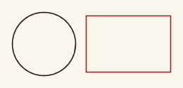

### `canvas.add(glyph, style), canvas.add(glyphs, style)`

Adds a placed glyph's strokes, or each of an array of glyphs', drawn in the style; an array's glyphs join up as glyphset.joined says.

| argument | what it does | takes |
|---|---|---|
| `glyph`, `glyphs` | What to draw, where it's placed. | a glyph, or an array of them (as glyphset.glyphs or textbox.fill give); a blank one (a space) adds nothing. |
| `style` | How the strokes are drawn: their brush style and handwriting. | a style, from new_style or default_style. |

### `canvas.add(other), canvas.add(canvases)`

Adds every stroke on another canvas, or each of an array of canvases (as fill_with_text gives), in its own style.

| argument | what it does | takes |
|---|---|---|
| `other`, `canvases` | The canvases whose strokes are copied. | a canvas (this one included), or an array of them. |

### `canvas.add(parts, styles)`

Adds each path of a map of parts, as art::bramble, art::eye, art::huffman_stars, art::moon and art::snake give them, in the style styles has under its name, in name order; parts with no style aren't drawn.

| argument | what it does | takes |
|---|---|---|
| `parts` | The paths, by name. | a map of names to paths, and to anything else so long as it isn't styled (as an eye's iris_radius). |
| `styles` | Their styles, by part name. | a map of part names to styles, every name one of the parts'. |

### `canvas.name = text`

The canvas's name in output files; without one, its index on the page.

| argument | what it does | takes |
|---|---|---|
| `text` | The canvas's name in output files. | a string of letters, digits, underscores, hyphens and dots, not starting with a dot, unique among its siblings. Reading it gives () until it's set. |

### `canvas.bounds()`

What the canvas's strokes cover, their widths included: #{ min, max, center, width, height }, min, max and center being vecs. Fails for an empty canvas.

### `canvas.translate_by(offset)`

Moves every stroke. Returns the canvas.

| argument | what it does | takes |
|---|---|---|
| `offset` | How far to move, across and down. | a vec. |

### `canvas.scale_by(factor)`

Scales every stroke about the origin; brush sizes stay as they are. Returns the canvas.

| argument | what it does | takes |
|---|---|---|
| `factor` | How many times bigger: below 1 shrinks, and negative flips through the origin. | a number. |

### `canvas.rotate_around(point, angle)`

Turns every stroke about a point. Returns the canvas.

| argument | what it does | takes |
|---|---|---|
| `point` | The centre of the turn. | a vec. |
| `angle` | How far to turn. Positive turns clockwise, y being down. | a number, in radians. |

```rhai render=canvas_rotate_around
let bar = new_canvas().add(new_rectangle(vec2(60, 60), 110, 24), PEN);
for i in 0..4 {
	page.add(bar.copy().rotate_around(vec2(60, 60), i * PI() / 4.0));
}
```

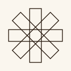

### `canvas.copy()`

An independent copy of the canvas.

## Vectors and Angles

Vecs are points and directions: vec2s on the page, and vec3s and vec4s for points of more coordinates, such as distribute_points gives for 3 or 4 bounds. They're values: methods give new vecs and leave the one they're called on as it was. Where an entry says a vec, it means a vec2.

### `vec2(x, y)`

A vec2, a point or direction on the page.

| argument | what it does | takes |
|---|---|---|
| `x` | How far across, growing to the right. | a finite number; infinity and NaN (from a division by zero, say) are refused. |
| `y` | How far down, growing down the page. | a finite number. |

### `v.x = number, v.y = number`

Its coordinates.

| argument | what it does | takes |
|---|---|---|
| `number` | The coordinate. | a finite number. |

### `a + b, a - b, -a`

Sums, differences and negation.

| argument | what it does | takes |
|---|---|---|
| `a`, `b` | The vecs. | vecs. |

### `v * number, number * v, v / number`

Scaled by a number.

| argument | what it does | takes |
|---|---|---|
| `v` | The vec. | a vec. |
| `number` | What it's multiplied, or divided, by. | a finite number, whole or decimal; not 0 to divide by. |

### `a == b, a != b`

Whether two vecs are the same.

| argument | what it does | takes |
|---|---|---|
| `a`, `b` | The vecs. | vecs. |

### `v.length()`

How long it is.

### `v.distance(other)`

How far it is from another vec.

| argument | what it does | takes |
|---|---|---|
| `other` | The other point. | a vec. |

### `v.dot(other)`

The dot product.

| argument | what it does | takes |
|---|---|---|
| `other` | The other vec. | a vec. |

### `v.angle()`

Its angle from the x axis, from -PI() to PI(); with y down, positive angles turn clockwise.

### `v.normalized()`

A vec of length 1, the same way. Fails for the zero vec.

### `v.rotated(angle)`

The vec turned about the origin.

| argument | what it does | takes |
|---|---|---|
| `angle` | How far to turn. Positive turns clockwise, y being down. | a number, in radians. |

### `v.to_string(), v.to_debug()`

The vec as text, (x, y), for print and debug.

### `vec3(x, y, z), vec3(v, z)`

A vec3: three coordinates.

| argument | what it does | takes |
|---|---|---|
| `x`, `y`, `z` | Its coordinates. | finite numbers. |
| `v` | Its x and y, from a vec2, with z after. | a vec2. |

### `vec4(x, y, z, w), vec4(v, w)`

A vec4: four coordinates.

| argument | what it does | takes |
|---|---|---|
| `x`, `y`, `z`, `w` | Its coordinates. | finite numbers. |
| `v` | Its x, y and z, from a vec3, with w after. | a vec3. |

### `v.x = number, v.y = number, v.z = number, v.w = number`

A vec3's or vec4's coordinates; only a vec4 has w.

| argument | what it does | takes |
|---|---|---|
| `number` | The coordinate. | a finite number. |

### `a + b, a - b, -a, v * number, number * v, v / number, a == b, a != b`

For vec3s and vec4s as for vec2s: sums, differences, scaling and comparison, between vecs of one size.

| argument | what it does | takes |
|---|---|---|
| `a`, `b` | The vecs. | two vec3s or two vec4s. |
| `number` | What it's multiplied, or divided, by. | a finite number; not 0 to divide by. |

### `v.length(), v.distance(other), v.dot(other), v.normalized()`

For vec3s and vec4s as for vec2s: how long, how far from another, the dot product, and length 1 the same way (failing for the zero vec).

| argument | what it does | takes |
|---|---|---|
| `other` | The other vec. | a vec of the same size. |

### `v.xy()`

A vec3's or vec4's first two coordinates, as a vec2: to draw it.

### `v.xyz()`

A vec4's first three coordinates, as a vec3.

### `a.cross(b)`

The cross product of two vec3s: at right angles to both, as long as the area they span.

| argument | what it does | takes |
|---|---|---|
| `b` | The other vec. | a vec3. |

### `degrees(d)`

An angle given in degrees, as the radians every angle is: degrees(180) is PI().

| argument | what it does | takes |
|---|---|---|
| `d` | The angle, in degrees. | a finite number. |

### `radians(r)`

An angle given in radians, as it is: for saying which unit a number is in.

| argument | what it does | takes |
|---|---|---|
| `r` | The angle, in radians. | a finite number. |

## Paths

A path is lines and curves, in one or more subpaths. Every path function changes the path and returns it, so statements, assignments and chains all work.

```rhai render=shapes
page.add(new_line(vec2(0, 0), vec2(80, 90)), PEN);
page.add(new_circle(vec2(150, 45), 40), PEN);
page.add(new_arc(vec2(250, 55), 45, 3.6, 5.8), RED_PEN);
page.add(new_ellipse(vec2(360, 45), 55, 28, #{ angle: 0.4 }), PEN);
page.add(new_polygon(vec2(480, 45), 42, 6), PEN);
page.add(new_polygon(vec2(580, 45), 42, 5, #{ step: 2 }), RED_PEN);
page.add(new_star(vec2(680, 45), 45, 18, 5), PEN);
```

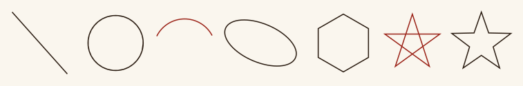

### `new_path()`

A new, empty path.

```rhai render=new_path
let p = new_path().move_to(vec2(0, 80))
	.quad_to(vec2(80, -40), vec2(160, 80))
	.cubic_to(vec2(200, 160), vec2(280, 0), vec2(320, 80));
page.add(p, PEN);
```

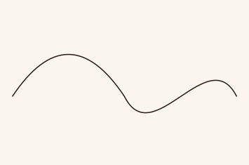

### `path.move_to(point)`

Starts a new subpath.

| argument | what it does | takes |
|---|---|---|
| `point` | Where it starts. | a vec. |

### `path.line_to(point)`

A straight line from where the path is.

| argument | what it does | takes |
|---|---|---|
| `point` | Where the line ends. | a vec. |

### `path.quad_to(control, point)`

A quadratic curve from where the path is.

| argument | what it does | takes |
|---|---|---|
| `control` | The point the curve bends toward. | a vec. |
| `point` | Where it ends. | a vec. |

### `path.cubic_to(control1, control2, point)`

A cubic curve from where the path is.

| argument | what it does | takes |
|---|---|---|
| `control1` | The point the curve leaves toward. | a vec. |
| `control2` | The point it arrives from. | a vec. |
| `point` | Where it ends. | a vec. |

### `path.close()`

Closes the subpath back to its start.

### `path.append(other)`

Adds a copy of another path's subpaths, so several shapes are one path: to hatch a shape with holes, say.

| argument | what it does | takes |
|---|---|---|
| `other` | The path whose subpaths are added. | a path, this one included. |

### `new_line(start, end)`

A straight line between two points.

| argument | what it does | takes |
|---|---|---|
| `start` | Where it starts. | a vec. |
| `end` | Where it ends. | a vec. |

### `new_circle(center, radius)`

A circle.

| argument | what it does | takes |
|---|---|---|
| `center` | Its centre. | a vec. |
| `radius` | How far its edge is from the centre. | a number. |

### `new_rectangle(center, width, height)`

A rectangle about its centre, its sides square to the page.

| argument | what it does | takes |
|---|---|---|
| `center` | Its centre. | a vec. |
| `width` | Its size across. | a number. |
| `height` | Its size down. | a number. |

### `new_arc(center, radius, start_angle, end_angle)`

An arc of a circle, from one angle to another, either way round.

| argument | what it does | takes |
|---|---|---|
| `center` | The circle's centre. | a vec. |
| `radius` | The circle's radius. | a number. |
| `start_angle` | Where the arc starts, from the x axis; positive angles are clockwise, y being down. | a number, in radians. |
| `end_angle` | Where it ends: it runs from start_angle toward this. | a number, in radians. |

### `new_polyline(points), new_polyline(points, options)`

Straight lines through points, in order.

| argument | what it does | takes |
|---|---|---|
| `points` | The corners. | an array of vecs. |

| option | default | what it does | takes |
|---|---|---|---|
| `options.closed` | false | Whether the last joins back to the first. | true or false. |

### `new_polygon(center, radius, sides), new_polygon(center, radius, sides, options)`

A regular polygon, its corners radius from the centre; or, with step, a star in one line.

| argument | what it does | takes |
|---|---|---|
| `center` | Its centre. | a vec. |
| `radius` | How far its corners are from the centre. | a number. |
| `sides` | How many corners. | a whole number from 3 to 10000. |

| option | default | what it does | takes |
|---|---|---|---|
| `options.angle` | -PI() / 2, up the page | Where its first corner is, from the centre. | a number, in radians. |
| `options.step` | 1 | Each corner joined to the step-th on: 5 sides and step 2 is a five-pointed star in one line. Where step and sides share a factor, there's a closed outline for each cycle of corners. | a whole number from 1 to sides - 1. |

### `new_star(center, outer, inner, points), new_star(center, outer, inner, points, options)`

A star's outline: its points outer from the centre, the corners between them inner.

| argument | what it does | takes |
|---|---|---|
| `center` | Its centre. | a vec. |
| `outer` | How far its points reach. | a number. |
| `inner` | How far in the corners between them are. | a number. |
| `points` | How many points. | a whole number from 2 to 10000. |

| option | default | what it does | takes |
|---|---|---|---|
| `options.angle` | -PI() / 2, up the page | Where its first point is, from the centre. | a number, in radians. |

### `new_ellipse(center, rx, ry), new_ellipse(center, rx, ry, options)`

An ellipse, as four curves.

| argument | what it does | takes |
|---|---|---|
| `center` | Its centre. | a vec. |
| `rx`, `ry` | Its radii across and down, before it's turned. | numbers. |

| option | default | what it does | takes |
|---|---|---|---|
| `options.angle` | 0 | How far it's turned. | a number, in radians. |

### `new_wave(start, end), new_wave(start, end, options)`

A wavy line from start to end, each wave a curve rising to its left and falling to its right: up first, going left to right across the page.

| argument | what it does | takes |
|---|---|---|
| `start` | Where it starts. | a vec. |
| `end` | Where it ends. | a vec. |

| option | default | what it does | takes |
|---|---|---|---|
| `options.amplitude` | a twentieth of its length | How far it rises and falls; negative falls first. | a number. |
| `options.waves` | 3 | How many waves. | a whole number from 1 to 10000. |

```rhai render=new_wave
page.add(new_wave(vec2(0, 30), vec2(360, 30), #{ amplitude: 25, waves: 3 }), PEN);
```

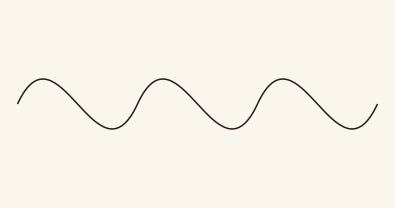

### `path.area()`

How much the path encloses: each subpath's area, closed back to its start, taken away where it's inside an odd number of the others, as a hole is. 0 for open lines.

### `path.bounds()`

What the path's lines cover: #{ min, max, center, width, height }. Fails for an empty path.

### `path.translate_by(offset)`

Moves the path.

| argument | what it does | takes |
|---|---|---|
| `offset` | How far to move, across and down. | a vec. |

### `path.scale_by(factor)`

Scales the path about the origin.

| argument | what it does | takes |
|---|---|---|
| `factor` | How many times bigger: below 1 shrinks, and negative flips through the origin. | a number. |

### `path.rotate_around(point, angle)`

Turns the path about a point.

| argument | what it does | takes |
|---|---|---|
| `point` | The centre of the turn. | a vec. |
| `angle` | How far to turn. Positive turns clockwise, y being down. | a number, in radians. |

### `path.copy()`

An independent copy of the path.

### `path.hatch(spacing), path.hatch(spacing, options)`

Shading for the inside of a closed path, as a new path (the path itself is unchanged), each line a stroke of its own. Every subpath is taken as a closed shape, and shapes inside or across others cut holes in them.

| argument | what it does | takes |
|---|---|---|
| `spacing` | How far apart the lines are. | a positive number. |

| option | default | what it does | takes |
|---|---|---|---|
| `options.angle` | PI() / 4 | Which way the lines run. | a number, in radians, or an array of them for a layer each (cross-hatching). |
| `options.roughness` | 0 | How far each line's ends are jittered, at most. | a number of at least 0. |
| `options.bow` | 0 | How far each line bends from straight, at most. | a number of at least 0. |
| `options.inset` | 0 | How far inside the outline lines stop. | a number of at least 0. |
| `options.fill_rule` | holes | Which parts of overlapping shapes are inside. | holes (shapes inside or across others cut holes in them), evenodd (which also leaves out where a single subpath crosses itself) or nonzero (overlapping shapes merge, as SVG fills do). |

```rhai render=hatch
let disc = new_circle(vec2(50, 50), 45);
page.add(disc, PEN);
page.add(disc.hatch(6.0, #{ angle: 0.8 }), RED_PEN);
```

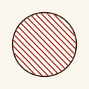

### `path.erase_inside(shape), path.erase_inside(shape, options)`

Cuts away the parts of the path a closed shape covers, as lines behind a figure are, in place; gives the same path. Lines and curves are cut where they cross the shape's outline and stay lines and curves; pieces that run on stay one stroke, and a closed subpath the shape doesn't touch stays closed.

| argument | what it does | takes |
|---|---|---|
| `shape` | What covers the path. Every subpath is taken as a closed shape, as for hatching. | a path, all its points finite. |

| option | default | what it does | takes |
|---|---|---|---|
| `options.fill_rule` | holes | Which parts of overlapping shapes are inside. | holes, evenodd or nonzero, as for hatch. |

```rhai render=erase_inside
let lines = new_path();
for i in 0..8 {
	lines.append(new_line(vec2(0, i * 14), vec2(300, i * 14)));
}
let disc = new_circle(vec2(150, 50), 42);
page.add(lines.erase_inside(disc), PEN);
page.add(disc, RED_PEN);
```

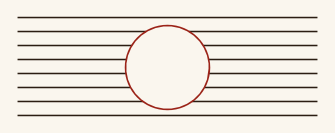

### `path.erase_outside(shape), path.erase_outside(shape, options)`

Cuts away the parts of the path outside a closed shape, keeping what it covers, in place; gives the same path. Cut as erase_inside cuts.

| argument | what it does | takes |
|---|---|---|
| `shape` | What to keep the path inside. Every subpath is taken as a closed shape, as for hatching. | a path, all its points finite. |

| option | default | what it does | takes |
|---|---|---|---|
| `options.fill_rule` | holes | Which parts of overlapping shapes are inside. | holes, evenodd or nonzero, as for hatch. |

### `path.points_along(count), path.points_along(count, options)`

count points evenly spaced along a path of one subpath, by length, each #{ position, angle }: where it is, and which way the path runs there (the angle a glyph turned to the path has). On a path that comes back to its start, as circles do, they go once round without doubling up at the start; on an open one the first and last are at its ends.

| argument | what it does | takes |
|---|---|---|
| `count` | How many points. | a whole number from 0 to 1000000. |

| option | default | what it does | takes |
|---|---|---|---|
| `options.start` | 0 | Where the first is, as a fraction of the length: 0.75 is the top of a circle, which starts at its right and runs clockwise. | a number from 0 to 1. |

```rhai render=points_along
let ring = new_circle(vec2(60, 60), 50);
page.add(ring, PEN);
for at in ring.points_along(12) {
	page.add(new_line(at.position, at.position + vec2(14, 0).rotated(at.angle - PI() / 2.0)), RED_PEN);
}
```

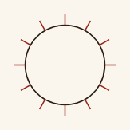

### `path.subpaths()`

Each subpath, from one move to the next, as a path of its own, in order: to give each piece of art its own style, say. Moves that draw nothing are left out.

### `path.is_empty`

Read only: whether the path has nothing in it, as a new moon's lit side.

### `path.to_string(), path.to_debug()`

The path's commands as text, for print and debug.

## Styles

A style is what strokes are drawn in: a brush style, the ink (a colour, a Darkly brush, how wide its marks are and how it presses), and a handwriting style, the hand (how it goes over its strokes, and sets glyphs and lines). A style's settings are its two parts', read and set on the style as one: style.color, style.passes. Styles and their parts are values: changing one changes that copy only. Every jitter is in canvas units (rotations in radians, scales a fraction), drawn from the journal's generator as strokes are added to a canvas.

### `new_style(brush_style, handwriting_style)`

A style: the ink and the hand. Its properties are both parts', below.

| argument | what it does | takes |
|---|---|---|
| `brush_style` | The ink; the style keeps a copy. | a brush style, from new_brush_style. |
| `handwriting_style` | The hand; the style keeps a copy. | a handwriting style, from new_handwriting_style. |

### `default_style()`

The plainest style: black, in an Ink Pen 1.2 wide pressing from 0.3 to 0.7, by a steady hand. Text calls, roles and borders given a map of style settings take them over this.

### `brush_names()`

The name of every Darkly brush, sorted.

### `new_brush_style(color, brush, brush_size), new_brush_style(color, brush, brush_size, options)`

A brush style. Pressure runs from min_pressure to max_pressure along each stroke, as its pressure_profile says. Options set its properties (below) as setting them does. In SVG output (--svg) a stroke is brush_size \* max_pressure wide.

| argument | what it does | takes |
|---|---|---|
| `color` | The ink. | a CSS colour, a gradient or image paint. |
| `brush` | Which Darkly brush draws. | one of brush_names(). |
| `brush_size` | How wide its marks are, in canvas units. | a positive number. |

| option | default | what it does | takes |
|---|---|---|---|
| `options.min_pressure` | 0.3 | As brush_style.min_pressure. | as brush_style.min_pressure. |
| `options.max_pressure` | 0.7 | As brush_style.max_pressure. | as brush_style.max_pressure. |
| `options.pressure_profile` | ramp | As brush_style.pressure_profile. | as brush_style.pressure_profile. |
| `options.pressure_wander` | 0 | As brush_style.pressure_wander. | as brush_style.pressure_wander. |
| `options.pressure_wander_length` | 12 | As brush_style.pressure_wander_length. | as brush_style.pressure_wander_length. |
| `options.pool` | 0 | As brush_style.pool. | as brush_style.pool. |
| `options.pool_depth` | 0.3 | As brush_style.pool_depth. | as brush_style.pool_depth. |
| `options.color_jitter` | 0 | As brush_style.color_jitter. | as brush_style.color_jitter. |
| `options.ink_load` | 0 | As brush_style.ink_load. | as brush_style.ink_load. |
| `options.redip_every` | 40 | As brush_style.redip_every. | as brush_style.redip_every. |
| `options.redip_by` | glyphs | As brush_style.redip_by. | as brush_style.redip_by. |

### `brush_style.color = color`

The ink.

| argument | what it does | takes |
|---|---|---|
| `color` | The ink. | a CSS colour, a gradient or image paint. |

### `brush_style.brush = name`

The Darkly brush.

| argument | what it does | takes |
|---|---|---|
| `name` | Which brush draws. | one of brush_names(). |

### `brush_style.brush_size = number`

How wide its marks are.

| argument | what it does | takes |
|---|---|---|
| `number` | The width, in canvas units. | a positive number. |

### `brush_style.min_pressure = number, brush_style.max_pressure = number`

The least and most pressure along a stroke: heavier marks the harder it presses, how much depending on the brush.

| argument | what it does | takes |
|---|---|---|
| `number` | The pressure. | a number from 0 to 1, min_pressure at most max_pressure (checked once a constructor's options are all set). |

### `brush_style.pressure_profile = name`

How pressure runs along each stroke.

| argument | what it does | takes |
|---|---|---|
| `name` | The profile. | ramp (min to max, the default), taper (min to max at the middle and back), constant (max all along) or pointed (by direction, as a pointed nib: max going down, min going up or across). |

```rhai render=pressure_profile
for (profile, i) in ["ramp", "constant", "pointed"] {
	let brush = new_brush_style(INK, "Ink Pen", 5, #{ pressure_profile: profile });
	page.add(new_line(vec2(0, i * 40), vec2(260, i * 40)), new_style(brush, new_handwriting_style()));
	page.add(write_line(profile, vec2(290, i * 40), TEXT));
}
```

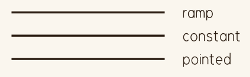

### `brush_style.pressure_wander = number`

Pressure wanders along a stroke, so ramps and tapers look less mechanical.

| argument | what it does | takes |
|---|---|---|
| `number` | How far it wanders either way, as a fraction of the pressure. Default 0. | a number from 0 up to, not including, 1. |

### `brush_style.pressure_wander_length = number`

How far apart the wandering pressure rises and falls.

| argument | what it does | takes |
|---|---|---|
| `number` | The distance, in canvas units. Default 12. | a positive number. |

### `brush_style.pool = number`

Ink pooling: strokes heavier at the very bottom of each path (each glyph, for text).

| argument | what it does | takes |
|---|---|---|
| `number` | How much heavier, as a fraction: 0.4 is 40% heavier. Default 0. | a number of at least 0. |

### `brush_style.pool_depth = number`

How far up the pooling rises.

| argument | what it does | takes |
|---|---|---|
| `number` | The height, as a fraction of the path's. Default 0.3. | a number above 0 and at most 1. |

### `brush_style.color_jitter = number`

Each stroke a little off its colour, each its own way: every subpath, so every pass of a stroke gone over, too. Colours move in OKLab, so steps look alike whatever the colour: lightness up to number either way, hue and chroma (OKLab's a and b) up to half that times the colour's lightness, so dark inks keep their hue, alpha kept. A gradient's colours move with its stroke, and image paint's with each stroke. Drawn from the journal's generator as strokes are added to a canvas.

| argument | what it does | takes |
|---|---|---|
| `number` | How far lightness moves, OKLab lightness running from 0 (black) to 1 (white): 0.05 is a slight variation. Default 0. | a number from 0 to 1. |

### `brush_style.ink_load = number`

A dip pen running dry: each stroke lighter and thinner than the last, its pressure and its colour's opacity falling off, slowly at first and faster as the dip runs out, until it's written redip_every since it was dipped, when it's this far down, and it's dipped again before its next word (a word it's in the middle of is finished dry). Strokes are counted in the order they're drawn on a canvas, every canvas starting freshly dipped, and each pen apart: strokes in another brush or colour have ink of their own. Nothing is drawn from the journal's generator.

| argument | what it does | takes |
|---|---|---|
| `number` | How far the ink falls off by the time the pen is dipped again, as a fraction: 0.4 is 40% lighter. Default 0, never running dry. | a number from 0 up to, not including, 1. |

### `brush_style.redip_every = number`

How much the pen writes between dips, as redip_by measures it.

| argument | what it does | takes |
|---|---|---|
| `number` | How many glyphs, or canvas units of stroke. Default 40. | a positive number. |

### `brush_style.redip_by = name`

What a dip is measured in: glyphs, each glyph written counting one (and a path that isn't text, one too), or the length of the strokes drawn, passes and all.

| argument | what it does | takes |
|---|---|---|
| `name` | Default glyphs. | glyphs or length. |

### `new_handwriting_style(), new_handwriting_style(options)`

A handwriting style: one clean pass, nothing astray, unless the options set its properties (below), as setting them does.

| option | default | what it does | takes |
|---|---|---|---|
| `options.passes` | 1 | As handwriting_style.passes. | as handwriting_style.passes. |
| `options.pass_end_jitter` | 0 | As handwriting_style.pass_end_jitter. | as handwriting_style.pass_end_jitter. |
| `options.stroke_point_jitter` | 0 | As handwriting_style.stroke_point_jitter. | as handwriting_style.stroke_point_jitter. |
| `options.stroke_warp` | 0 | As handwriting_style.stroke_warp. | as handwriting_style.stroke_warp. |
| `options.stroke_warp_length` | 20 | As handwriting_style.stroke_warp_length. | as handwriting_style.stroke_warp_length. |
| `options.glyph_position_jitter` | 0 | As handwriting_style.glyph_position_jitter. | as handwriting_style.glyph_position_jitter. |
| `options.glyph_rotation_jitter` | 0 | As handwriting_style.glyph_rotation_jitter. | as handwriting_style.glyph_rotation_jitter. |
| `options.glyph_scale_jitter` | 0 | As handwriting_style.glyph_scale_jitter. | as handwriting_style.glyph_scale_jitter. |
| `options.baseline_wander` | 0 | As handwriting_style.baseline_wander. | as handwriting_style.baseline_wander. |

```rhai render=handwriting
let steady = new_handwriting_style();
let shaky = new_handwriting_style(#{ passes: 3, pass_end_jitter: 3.0, stroke_warp: 3.0 });
page.add(new_circle(vec2(50, 50), 45), new_style(new_brush_style(INK, "Ink Pen", 1.6), steady));
page.add(new_circle(vec2(170, 50), 45), new_style(new_brush_style(INK, "Ink Pen", 1.6), shaky));
```

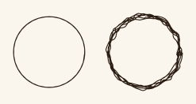

### `handwriting_style.passes = number`

Draws each stroke this many times over, as a hand going over its writing.

| argument | what it does | takes |
|---|---|---|
| `number` | How many passes. Default 1. | a whole number from 1 to 64. |

### `handwriting_style.pass_end_jitter = number`

How far each pass's ends stray, each its own way, so a pass shifts, turns and stretches. With one pass it just roughens a hand.

| argument | what it does | takes |
|---|---|---|
| `number` | How far, in canvas units. Default 0. | a number of at least 0. |

### `handwriting_style.stroke_point_jitter = number`

How far every point of every pass strays, control points included, each its own way, so curves change shape rather than just shifting. On top of pass_end_jitter.

| argument | what it does | takes |
|---|---|---|
| `number` | How far, in canvas units. Default 0. | a number of at least 0. |

### `handwriting_style.stroke_warp = number`

A hand's slow tremor: every pass of every stroke bent by smooth noise along it, so lines waver and curves wobble rather than fuzz, each pass its own way. Long straight segments are cut into pieces to bend too. After pass_end_jitter, before stroke_point_jitter. Drawn from the journal's generator as strokes are added to a canvas.

| argument | what it does | takes |
|---|---|---|
| `number` | How far a point moves, at most, across and down, in canvas units. Default 0. | a number of at least 0. |

### `handwriting_style.stroke_warp_length = number`

How far along a stroke the tremor takes to turn.

| argument | what it does | takes |
|---|---|---|
| `number` | The distance, in canvas units: short shakes, long sways. Default 20. | a positive number. |

### `handwriting_style.glyph_position_jitter = number`

How far each glyph text calls place strays, at most, either way.

| argument | what it does | takes |
|---|---|---|
| `number` | How far, in canvas units. Default 0. | a number of at least 0, or [across, down]. |

### `handwriting_style.glyph_rotation_jitter = number`

How far each placed glyph turns, at most, either way.

| argument | what it does | takes |
|---|---|---|
| `number` | How far, in radians. Default 0. | a number of at least 0. |

### `handwriting_style.glyph_scale_jitter = number`

How much each placed glyph's size changes, at most, either way.

| argument | what it does | takes |
|---|---|---|
| `number` | How much, as a fraction. Default 0. | a number from 0 up to, not including, 1. |

### `handwriting_style.baseline_wander = number`

How far the lines write_line, write_block, text boxes and write_inside_path write along wander up and down from straight: smoothly, at random, starting where they're put and bending every few glyph scales. Glyphs follow them; in a text box, a glyph a line's wander takes past the shape's edge (further than the paragraph's overhang) goes on the next line.

| argument | what it does | takes |
|---|---|---|
| `number` | How far, at most, either way, in canvas units. Default 0. | a number of at least 0. |

### `style.SETTING = value`

Any brush style or handwriting style setting, read and set on the style: style.color, style.brush_size, style.passes, style.glyph_rotation_jitter and the rest, each taking what it takes above.

| argument | what it does | takes |
|---|---|---|
| `value` | The setting's value. | as its part takes it. |

## Gradients

### `new_gradient(colors)`

A gradient along each stroke from its start to its end, to use in place of a colour.

| argument | what it does | takes |
|---|---|---|
| `colors` | The colours, in order. Unplaced colours at the ends sit at 0 and 1, and the others evenly between their placed neighbours. | an array of at least two, each a CSS colour or [position, colour] with the position from 0 to 1; positions mustn't go back. |

```rhai render=gradient
let brush = new_brush_style(new_gradient([RED, INK]), "Ink Pen", 8, #{ pressure_profile: "constant" });
page.add(new_wave(vec2(0, 30), vec2(400, 30), #{ amplitude: 20, waves: 2 }), new_style(brush, new_handwriting_style()));
```

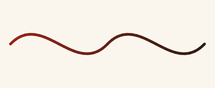

### `new_gradient(colors, options)`

A gradient laid out another way: give from and to, center and radius, or vertical, or no key for along each stroke. In Darkly renders a gradient stroke keeps its brush's texture; in SVG, gradients along or down a stroke are drawn in short pieces.

| argument | what it does | takes |
|---|---|---|
| `colors` | The colours, as above. | an array of at least two colours or [position, colour] pairs. |

| option | default | what it does | takes |
|---|---|---|---|
| `options.from` | none | With to: the gradient runs across the page from this point. | a vec or [x, y], not the same as to. |
| `options.to` | none | With from: the point it runs to. | a vec or [x, y]. |
| `options.center` | none | With radius: the gradient spreads out from this point. | a vec or [x, y]. |
| `options.radius` | none | With center: how far it spreads. | a positive number. |
| `options.vertical` | false | True runs the gradient down each path (each glyph, for text) from its top to its bottom. | true or false; true takes no other key. |

### `gradient.to_string(), gradient.to_debug()`

The gradient as text, for print and debug.

A colour option of a style, layout or illustration file, one whose default is a colour or a gradient, takes a colour or a gradient: whole, from new_gradient, or as data, a map of colors and new_gradient's options, as the web editor and JSON write it: #{ colors: [...], vertical: true }. It takes image paint too, whole. The file sees a colour, a gradient or image paint either way, and can give it to new_brush_style or style.color as it stands.

## Images

A journal's pictures are its images/ files, NAME.png or NAME.jpg, the journal's own or the library's. Image paint lays one over the canvas to draw in: each stroke drawn in it, each subpath of a path (each pen stroke of a glyph, each pass of a stroke gone over), is all one colour, the picture's where the stroke is halfway along, blended between its nearest pixels. Small text in it draws the picture. In Darkly renders each stroke is drawn in its colour, so every brush works with it; in SVG, each subpath is drawn in its colour. Image paint that avoids colours keeps text off the parts of the picture in them: text drawn in it (any text call whose style is in it, and typeset roles) wraps round them as round anything in its avoid, and it can be given to avoid, or added to a tree, as what to keep clear of.

### `image(name)`

A picture, images/NAME.png or NAME.jpg, decoded once however often it's asked for.

| argument | what it does | takes |
|---|---|---|
| `name` | Which picture; there mustn't be both a .png and a .jpg of that name. | a picture's name without its extension. |

### `image.name, image.width, image.height`

The picture's name, and its size in pixels: read only.

### `image.to_string(), image.to_debug()`

The picture as text, its name and size, for print and debug.

### `new_image_paint(image), new_image_paint(image, options)`

Image paint, to use in place of a colour: the picture laid over the canvas, its top-left corner at at. Beyond the picture, strokes take the colour at its nearest edge. It's laid in canvas units, as a gradient across the page is: moving a canvas after drawing on it moves its strokes, not the picture. style.color reads it back.

| argument | what it does | takes |
|---|---|---|
| `image` | The picture. | an image, from image. |

| option | default | what it does | takes |
|---|---|---|---|
| `options.at` | vec2(0, 0) | Where the picture's top-left corner is. | a vec. |
| `options.width` | the picture's width in pixels, or from height | How wide it's laid. With only height, the width keeps the picture's shape. | a positive number of canvas units. |
| `options.height` | the picture's height in pixels, or from width | How tall it's laid. With only width, the height keeps the picture's shape; with both, the picture's stretched. | a positive number of canvas units. |
| `options.avoid` | none | Colours text keeps clear of: where the picture is in one of them is avoided, as if covered by a region. The picture is looked at in a grid of at most 512 cells along its longer side, a cell being avoided when its pixels' average colour is within avoid_tolerance of one of them. | a colour, or an array of colours. |
| `options.avoid_tolerance` | 0.1 | How near a colour must be to one avoided, as a distance in OKLab: 0 matches it exactly; about 0.1 takes its shades. | a number of at least 0. |

### `image_paint.to_string(), image_paint.to_debug()`

The image paint as text, its picture and where it's laid, for print and debug.

## Glyphsets and Glyphs

Glyphsets come from the glyphset files, glyphsets/NAME.json, the journal's own and the library's, one per glyphset (copper.json is the glyphset copper), each with its glyphs and how text is set in it by default; sets of symbols are glyphsets too. A glyphset is a value: changing one changes that copy. A character is looked for as it is in a glyphset and its fallbacks, then in the other case, so a glyphset of capitals sets lowercase text in them. A type style can override a glyphset's settings for the text it sets (see Text).

### `glyphset(name)`

A glyphset, as its file sets it.

| argument | what it does | takes |
|---|---|---|
| `name` | Which glyphset. | one of glyphset_names(). |

### `glyphset(name, options)`

A glyphset with settings changed, as setting the properties below does.

| argument | what it does | takes |
|---|---|---|
| `name` | Which glyphset. | one of glyphset_names(). |

| option | default | what it does | takes |
|---|---|---|---|
| `options.glyph_outline_gap` | the file's | Room between glyphs' outlines, in glyph scales. | a number of at least 0. |
| `options.space_width` | the file's | A space's width, in glyph scales. | a positive number. |
| `options.skew` | the file's | Leans the glyphs into italics, tops forward. | a number, in radians, between -PI() / 2 and PI() / 2. |
| `options.joined` | true if the file gives joins | As glyphset.joined. | as glyphset.joined. |
| `options.fallback` | the file's | Where characters the glyphset hasn't are looked for. | a glyphset, a glyphset's name, or () for nowhere. |

### `glyphset_names()`

Every glyphset's name, sorted.

### `ternary_glyphset(name), ternary_glyphset(name, options)`

A glyphset whose letters are balanced-ternary digits: a to m are 1 to 13, n to z are -13 to -1.

| argument | what it does | takes |
|---|---|---|
| `name` | The glyphset whose glyphs draw the digits. | one of glyphset_names(). |

| option | default | what it does | takes |
|---|---|---|---|
| `options` | none | The glyphset's settings, as glyphset(name, options) takes them. | a map of glyph_outline_gap, space_width, skew, joined and fallback. |

### `glyphset.name`

Read only: the glyphset's name.

### `glyphset.glyph_outline_gap = number`

Text is set with each glyph as close to the last as their outlines allow, plus this.

| argument | what it does | takes |
|---|---|---|
| `number` | The room between outlines, in glyph scales. | a number of at least 0. |

### `glyphset.space_width = number`

A space's width.

| argument | what it does | takes |
|---|---|---|
| `number` | The width, in glyph scales. | a positive number. |

### `glyphset.skew = angle`

Leans the glyphset's glyphs, and its fallbacks', into italics. Spacing isn't opened up.

| argument | what it does | takes |
|---|---|---|
| `angle` | How far they lean, tops forward; negative leans them back. | a number, in radians, between -PI() / 2 and PI() / 2. |

### `glyphset.joined = on`

Whether a cursive glyphset's words are joined up, each written in one stroke: each glyph's first stroke, joined to the next's by a stroke along both, then their lifts (dots and crossbars). Glyphs join where the file's joins says they do and they're less than 2.6 x-heights apart, end to start (the glyphset's x-height, from the file's joins baseline up to its x_height, at the larger glyph's scale), so text set apart (at a line's end, round what it avoids, by hand) isn't joined; blanks, and changes of ink in marked-up text, break joins. Text calls and canvas.add(glyphs, style) join glyphs; canvas.add(glyph, style) and glyph.path() don't. A glyph after one in the file's leave_high is drawn as a variant entered high, if it has one.

| argument | what it does | takes |
|---|---|---|
| `on` | Whether they join. Default true for a glyphset whose file gives joins. | true or false; true only for a glyphset whose file gives joins. |

### `glyphset.fallback = glyphset`

Where characters the glyphset hasn't are looked for.

| argument | what it does | takes |
|---|---|---|
| `glyphset` | The fallback. | a glyphset, a glyphset's name, or () for nowhere. |

### `glyphset.characters()`

The characters the glyphset has glyphs for.

### `glyphset.glyphs(text)`

A text's glyphs, each at the origin with scale 1, variants picked from the seeded generator, looked for in the fallbacks too.

| argument | what it does | takes |
|---|---|---|
| `text` | The text to set. | a string; characters with no glyph anywhere come out as X (see missing_glyphs). |

### `glyphset.glyph(name), glyphset.glyph(name, options)`

One glyph, its first variant, from the glyphset's own glyphs (not its fallbacks), placed as the options say.

| argument | what it does | takes |
|---|---|---|
| `name` | Which glyph. | a character or a glyph's name, as a string, a number (as ternary.glyph(-13)), or a balanced-ternary value (its number). |

| option | default | what it does | takes |
|---|---|---|---|
| `options.position` | the origin | As glyph.position. | as glyph.position. |
| `options.scale` | 1 | As glyph.scale. | as glyph.scale. |
| `options.rotation` | 0 | As glyph.rotation. | as glyph.rotation. |
| `options.skew` | 0 | As glyph.skew. | as glyph.skew. |

```rhai render=glyph
let symbols = glyphset("symbols");
for (name, i) in symbols.characters() {
	page.add(symbols.glyph(name, #{ scale: 40, position: vec2(i * 60, 0) }), PEN);
}
```

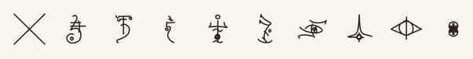

### `glyphset.variants(name)`

Every variant of one of the glyphset's own glyphs.

| argument | what it does | takes |
|---|---|---|
| `name` | Which glyph. | a character or a glyph's name, as a string, or a number. |

### `missing_glyphs()`

Characters drawn with the fallback X so far, for want of a glyph: #{ CHARACTER: #{ count, tried } }. journalbuild --strict-glyphs fails on them instead.

A glyph is a symbol placed with a position, scale, rotation and skew. Its path spans -1 to 1 and is drawn at half its scale, so scale is its size in canvas units.

### `glyph.position = vec`

Where its centre is.

| argument | what it does | takes |
|---|---|---|
| `vec` | The centre. | a vec. |

### `glyph.scale = number`

Its size.

| argument | what it does | takes |
|---|---|---|
| `number` | The size, in canvas units. | a number. |

### `glyph.rotation = angle`

Its turn about its own centre.

| argument | what it does | takes |
|---|---|---|
| `angle` | The turn. Positive turns clockwise, y being down. | a number, in radians. |

### `glyph.skew = angle`

Its lean about its centre, before it's turned.

| argument | what it does | takes |
|---|---|---|
| `angle` | How far it leans, top forward. | a number, in radians, between -PI() / 2 and PI() / 2. |

### `glyph.is_blank`

Read only: whether it draws nothing, as a space.

### `glyph.translate_by(offset)`

Moves it. Returns the glyph.

| argument | what it does | takes |
|---|---|---|
| `offset` | How far to move, across and down. | a vec. |

### `glyph.scale_by(factor)`

Multiplies its scale. Returns the glyph.

| argument | what it does | takes |
|---|---|---|
| `factor` | How many times bigger. | a number. |

### `glyph.rotate_by(angle)`

Turns it further. Returns the glyph.

| argument | what it does | takes |
|---|---|---|
| `angle` | How much further. Positive turns clockwise, y being down. | a number, in radians. |

### `glyphs.translate_by(offset), glyphs.scale_by(factor), glyphs.rotate_around(point, angle)`

An array of glyphs moved, scaled about the origin (positions and sizes alike), or turned about a point, as one: each glyph changed. Returns the array.

| argument | what it does | takes |
|---|---|---|
| `offset` | How far to move, across and down. | a vec. |
| `factor` | How many times bigger. | a number. |
| `point` | The centre of the turn. | a vec. |
| `angle` | How far to turn. Positive turns clockwise, y being down. | a number, in radians. |

### `glyph.path()`

Its strokes, placed, as a new path; empty for blanks.

### `glyph.copy()`

An independent copy of the glyph.

## Text

Text layouts place glyphs, scaling each by the glyph scale and turning it to its line on top of any scale and rotation it has. Every text call takes one settings map: a style (what the glyphs are drawn in, and the hand that sets them), a type (which glyphs, how big, shaped how) and a paragraph (how lines are built and set), each whole or a map of some of its settings, and the call's own options. A map of style settings is over default_style(); of type settings, over no glyphset and no glyph scale; of paragraph settings, over the defaults. A call uses the settings it needs and ignores the rest, spans among them, so a role or a text_style(name) can be passed straight in; unknown keys are errors.

Settings every text call takes:

| key | default | what it does | takes |
|---|---|---|---|
| `settings.style` | default_style() | What the glyphs are drawn in; its hand's glyph jitters set each a little off true, and its baseline_wander bends write_line's and write_block's lines. | a style, or a map of style settings. |
| `settings.type` | none | The glyphset and glyph scale, and how glyphs are shaped and spaced. Calls that set text from a string need its glyphset; all but fit_text and art::spiral_text need its glyph_scale. | a type style, or a map of type settings. |
| `settings.paragraph` | the defaults below | How lines are built and set. | a paragraph style, or a map of paragraph settings. |
| `settings.spans` | none | Named spans for marked-up text, as a role has them: `[text]{name}` sets text in one. Plain text ignores them. | a map of span names to spans (see Marked-Up Text). |

### `new_type_style(glyphset, glyph_scale), new_type_style(glyphset, glyph_scale, options)`

A type style: the glyphs text is set in and their scale, shaped as the options say, as setting the properties below does. Settings left unset are the glyphset's.

| argument | what it does | takes |
|---|---|---|
| `glyphset` | The glyphs text is set in. | a glyphset, from glyphset or ternary_glyphset. |
| `glyph_scale` | The size glyphs are set at, in canvas units. | a positive number. |

| option | default | what it does | takes |
|---|---|---|---|
| `options.glyph_scale_factor` | 1 | As type_style.glyph_scale_factor. | as type_style.glyph_scale_factor. |
| `options.glyph_outline_gap` | the glyphset's | As type_style.glyph_outline_gap. | as type_style.glyph_outline_gap. |
| `options.glyph_tracking` | 0 | As type_style.glyph_tracking. | as type_style.glyph_tracking. |
| `options.space_width` | the glyphset's | As type_style.space_width. | as type_style.space_width. |
| `options.skew` | the glyphset's | As type_style.skew. | as type_style.skew. |
| `options.italic` | the glyphset's | As type_style.italic. | as type_style.italic. |
| `options.joined` | the glyphset's | As type_style.joined. | as type_style.joined. |
| `options.underline` | false | As type_style.underline. | as type_style.underline. |
| `options.strike` | false | As type_style.strike. | as type_style.strike. |

### `type_style.glyphset = glyphset`

The glyphs text is set in.

| argument | what it does | takes |
|---|---|---|
| `glyphset` | The glyphset. | a glyphset. |

### `type_style.glyph_scale = number`

The size glyphs are set at.

| argument | what it does | takes |
|---|---|---|
| `number` | The size, in canvas units. | a positive number. |

### `type_style.glyph_scale_factor = number`

Multiplies the glyph scale. In a span, it multiplies the size of the text round it.

| argument | what it does | takes |
|---|---|---|
| `number` | How many times bigger. Default 1. | a positive number. |

### `type_style.glyph_outline_gap = number`

Room between glyphs' outlines, over the glyphset's; glyphs from its fallbacks take it too in spans.

| argument | what it does | takes |
|---|---|---|
| `number` | The room, in glyph scales. | a number of at least 0. |

### `type_style.glyph_tracking = number`

Extra room after each glyph; negative tightens.

| argument | what it does | takes |
|---|---|---|
| `number` | The room, in glyph scales. Default 0. | a number above -0.5. |

### `type_style.space_width = number`

A space's width, over the glyphset's.

| argument | what it does | takes |
|---|---|---|
| `number` | The width, in glyph scales. | a positive number. |

### `type_style.skew = angle, type_style.italic = on`

Leans the glyphs, over the glyphset's skew: italic true leans them 0.25 radians, false sets them upright.

| argument | what it does | takes |
|---|---|---|
| `angle` | How far they lean, tops forward. | a number, in radians, between -PI() / 2 and PI() / 2. |
| `on` | Whether the text is italic. | true or false. |

### `type_style.joined = on`

Whether a cursive glyphset's words are joined up, over the glyphset's (see glyphset.joined).

| argument | what it does | takes |
|---|---|---|
| `on` | Whether they join; true joins only a glyphset whose file gives joins. | true or false. |

### `type_style.underline = lines, type_style.strike = lines`

Lines under the text, one below another, or through it, back and forth as one stroke, scribbling it out. A strike can instead hide the text under one stroke made by hand, reaching a little above and below it: a scribble, a tight zigzag back and forth across it working down it; loops, a coil of loops along it; or a blot, rows back and forth filling a lumpy round of ink. Drawn where text is typeset (flows and labels, and spans in markdown); lines run across the spaces between words and break where the text does.

| argument | what it does | takes |
|---|---|---|
| `lines` | Which lines. | true for one, false for none, a number of lines from 1 to 20, or #{ count, spacing, style }: count lines (default 1), spacing glyph scales apart (default as the pen sets them), drawn in style, a style or a map of style settings over the text's (default the text's). A strike also takes kind, and a kind's name alone (strike: scribble is #{ kind: scribble }). |

| option | default | what it does | takes |
|---|---|---|---|
| `lines.kind` | lines | How a strike strikes the text out; count is then how many times across (a scribble down and back up, loops there and back) or a blot's coats, and spacing (in glyph scales) how far apart a scribble's sweeps are (default 0.08), a coil's loops (default 0.3) or a blot's rows (default half the pen's width). | lines, scribble, loops or blot; strikes only. |

### `new_paragraph_style(), new_paragraph_style(options)`

A paragraph style: the defaults below unless the options set them, as setting the properties does.

| option | default | what it does | takes |
|---|---|---|---|
| `options.KEY` | as below | Any of the properties below. | as each takes. |

### `paragraph_style.line_height = number`

How far apart lines are, in glyph scales. Text boxes and write_inside_path space lines by their ink (each line as far below the last as its tallest glyph) unless it's set; set, lines are that far apart, or further where a line's ink is taller.

| argument | what it does | takes |
|---|---|---|
| `number` | Default 1.25 (unset, for text boxes). | a positive number. |

### `paragraph_style.paragraph_gap = number, paragraph_style.indent = number`

Extra room between paragraphs, in lines (default 0.5); and how much further in a paragraph's first line starts, in glyph scales (default 0). Typeset text.

| argument | what it does | takes |
|---|---|---|
| `number` | The room. | a number of at least 0. |

### `paragraph_style.align = name`

Where each line's glyphs go along it: from its start; moved along as far as they still fit, or half that; or spread so the last goes as far as it fits (at the blanks, with layout: words), all but the text's last line. In write_block, a line's room is its width: its glyphs go as far along as leaves the room after the last's ink what's before the first's, or half that, or spread so the last does.

| argument | what it does | takes |
|---|---|---|
| `name` | Default left. | left, center, right or justify. |

### `paragraph_style.valign = name`

Where text sits down a text box or slot: from as high as its glyphs fit, or set again lower by half, or all, of the room left under its last line.

| argument | what it does | takes |
|---|---|---|
| `name` | Default top. | top, center or bottom. |

### `paragraph_style.fit = on`

Shrinks the text until all of it fits its slot. Typeset text, and write_inside_path (all of it inside the path).

| argument | what it does | takes |
|---|---|---|
| `on` | Default false. | true or false. |

### `paragraph_style.layout = name`

How glyphs are placed: glyph by glyph, or words kept whole, wrapping at spaces.

| argument | what it does | takes |
|---|---|---|
| `name` | Default the call's: words for write_block, flat otherwise. | flat or words. |

### `paragraph_style.angle = angle`

In a text box, which way its lines run (0, the default, left to right, each line below the last; other angles turn them, the next line always to their right-hand side). Along a path, holds every glyph at this angle instead of turning it with the path (0 is upright).

| argument | what it does | takes |
|---|---|---|
| `angle` | Default none: 0 in a box, turned to the path along one. | a number, in radians. |

### `paragraph_style.split_words = setting, paragraph_style.split_padding = number`

With layout: words, breaks words round what's avoided rather than moving them past it whole; and how much further the pieces keep from it.

| argument | what it does | takes |
|---|---|---|
| `setting` | Default false. | true, false, or the fewest glyphs a piece may have (a whole number of at least 1; true is 2). |
| `number` | The extra room, in glyph scales. Default 0. Needs split_words. | a number of at least 0. |

### `paragraph_style.break_words = setting`

With layout: words, cuts a word that doesn't fit at the end of a line (or of a piece of one, beside what's avoided or a shape's edge), as much of it as fits going there and the rest on the next. Otherwise words are kept whole, and only a word longer than a whole line is broken. In text boxes, write_inside_path, fill_with_text and layouts.

| argument | what it does | takes |
|---|---|---|
| `setting` | Default false. | true, false, or the fewest glyphs a piece may have, either side of the cut (a whole number of at least 1; true is 2). |

### `paragraph_style.clearance = number`

How far glyphs keep from what they avoid, on top of any margin a tree was built with.

| argument | what it does | takes |
|---|---|---|
| `number` | In canvas units. Default 3. | a number of at least 0. |

### `paragraph_style.line_start_jitter = number, paragraph_style.line_gap_jitter = number`

How much further each line starts, at most, at random; and how much each line's distance from the last varies, at most, either way (write_block, text boxes, write_inside_path and typeset text). In a text box, a line that starts further in isn't aligned. In write_block, it's aligned within what's left: a line set right ends up to that much short of the width instead, and a centred one starts in or ends short, either, at random, so its middle strays up to half that from the width's.

| argument | what it does | takes |
|---|---|---|
| `number` | In canvas units. Default 0. | a number of at least 0. |

### `paragraph_style.overhang = number`

How far glyphs' ink may reach past a text box's edge (new_textbox and write_inside_path): a glyph reaching further goes on the next line. Lines may start that far above the shape's top.

| argument | what it does | takes |
|---|---|---|
| `number` | In canvas units. Default 0: ink wholly inside. | a number of at least 0. |

### `new_textbox(settings)`

A box, or any closed shape, glyphs flow into, line by line, each glyph's own ink wholly inside the shape: lines run from where the first glyph fits to where the last does, so ink meets the shape's edges, and the first line starts as near its top as glyphs fit. Takes the type's glyph_scale and glyph_tracking, the paragraph's line_height (if set, lines at least that far apart; unset, spaced by their ink), layout (default flat), align, valign, angle, line_start_jitter, line_gap_jitter, overhang, clearance, splitting and breaking words, and the style's glyph jitters and baseline_wander.

| option | default | what it does | takes |
|---|---|---|---|
| `settings.center` | none: give center, width and height, or shape | The box's centre. | a vec. |
| `settings.width` | none: needed with center | Its width. | a positive number. |
| `settings.height` | none: needed with center | Its height. | a positive number. |
| `settings.shape` | none: give it, or center, width and height | The shape to fill instead of a box. Each subpath is an outline, closed back to its start, filled where it winds round (so one drawn on past its start, as circles are, is still filled); a place inside an even number of outlines, as in one inside another, is outside. A rectangle at angle 0 fills just as a box does. | a path with a subpath of at least three points. |
| `settings.avoid` | nothing | What glyphs keep clear of (see Keeping Text Clear). | an avoidance tree, a path, a canvas, a glyph or image paint, or an array of any of these. |

### `textbox.fill(glyphs)`

Places what fits: #{ placed, unplaced }, arrays of glyphs. Add the placed ones to a canvas with canvas.add(placed, style).

| argument | what it does | takes |
|---|---|---|
| `glyphs` | The glyphs to place, in order. | an array of glyphs, as glyphset.glyphs gives. |

### `textbox.place_all(glyphs)`

Fills the box again and again until every glyph is placed: an array of arrays of placed glyphs, one per box. Fails if a glyph won't fit even an empty box.

| argument | what it does | takes |
|---|---|---|
| `glyphs` | The glyphs to place, in order. | an array of glyphs. |

### `path.fill_with_text(text, settings)`

The text along the path, each glyph turned to it (or held at the paragraph's angle), over as many copies of the path as it takes: an array of canvases, one per copy. Takes the type's glyphset, glyph_scale and glyph_tracking, the paragraph's layout (default flat; words aren't split between subpaths unless it has break_words), angle, clearance, splitting and breaking words, and the style. Fails if a glyph won't fit the path at all.

| argument | what it does | takes |
|---|---|---|
| `text` | The text to write; marked up, its spans are set as it's written (see Marked-Up Text). | a string, or markdown(text). |

| option | default | what it does | takes |
|---|---|---|---|
| `settings.avoid` | nothing | What glyphs keep clear of (see Keeping Text Clear). | an avoidance tree, a path, a canvas, a glyph or image paint, or an array of any of these. |

```rhai render=fill_with_text
let wave = new_wave(vec2(0, 40), vec2(420, 40), #{ amplitude: 30, waves: 2 });
page.add(wave.fill_with_text("lorem ipsum dolor sit amet, consectetur adipiscing elit ", #{ style: TEXT.style, type: new_type_style(PLAIN, 20) })[0]);
```

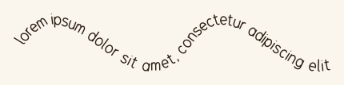

### `path.fit_text(text, settings)`

The text along the path at the largest glyph scale that fits all of it, as a canvas; a glyph_scale is ignored. Otherwise as fill_with_text.

| argument | what it does | takes |
|---|---|---|
| `text` | The text to write; marked up, its spans are set as it's written (see Marked-Up Text). | a string, or markdown(text). |

| option | default | what it does | takes |
|---|---|---|---|
| `settings.avoid` | nothing | What glyphs keep clear of (see Keeping Text Clear). | an avoidance tree, a path, a canvas, a glyph or image paint, or an array of any of these. |

```rhai render=fit_text
let arc = new_arc(vec2(200, 200), 180, 3.6, 5.8);
page.add(arc, RED_PEN);
page.add(arc.fit_text("lorem ipsum dolor sit amet", #{ style: TEXT.style, type: #{ glyphset: PLAIN } }));
```

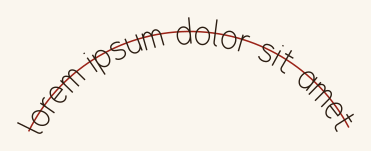

### `write_line(text, at, settings)`

The text written from at to the right, on the line through at (wandering by the hand's baseline_wander), as a canvas: glyphs' centres on it, as along any path. Otherwise as fill_with_text.

| argument | what it does | takes |
|---|---|---|
| `text` | The text to write; marked up, its spans are set as it's written (see Marked-Up Text). | a string, or markdown(text). |
| `at` | Where the line starts. | a vec. |

| option | default | what it does | takes |
|---|---|---|---|
| `settings.avoid` | nothing | What glyphs keep clear of (see Keeping Text Clear). | an avoidance tree, a path, a canvas, a glyph or image paint, or an array of any of these. |

```rhai render=write_line
page.add(write_line("Lorem ipsum dolor sit amet", vec2(0, 0), TEXT));
```

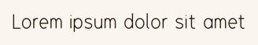

### `write_block(text, at, width, settings)`

The text wrapped into lines width long, the first from at (on its line, as write_line sets it) and each line_height glyph scales below the last (give or take line_gap_jitter), each wandering by the hand's baseline_wander, each set as the paragraph's align says, ragged by line_start_jitter (see paragraph_style.line_start_jitter), words kept whole unless the paragraph's layout is flat or it has break_words. Gives #{ canvas, bottom }: the text, and where a line after it would go, for stacking blocks.

| argument | what it does | takes |
|---|---|---|
| `text` | The text to write; marked up, its spans are set as it's written (see Marked-Up Text). | a string, or markdown(text). |
| `at` | Where the first line starts. | a vec. |
| `width` | How long lines are. | a positive number. |

| option | default | what it does | takes |
|---|---|---|---|
| `settings.avoid` | nothing | What glyphs keep clear of (see Keeping Text Clear). | an avoidance tree, a path, a canvas, a glyph or image paint, or an array of any of these. |

```rhai render=write_block
let block = write_block("Lorem ipsum dolor sit amet, consectetur adipiscing elit, sed do eiusmod tempor incididunt ut labore et dolore magna aliqua.", vec2(0, 0), 500, TEXT);
page.add(block.canvas);
page.add(new_line(vec2(0, block.bottom), vec2(500, block.bottom)), RED_PEN);
```

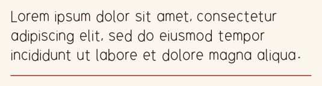

Aligned, and ragged: centred lines each start in or end short by up to line_start_jitter.

```rhai render=write_block_align
let text = "Follow the red thread until you find To Fall Endlessly, then use the crawlspace beneath the broken shelf.";
let x = 0;
for align in ["right", "center", "justify"] {
	page.add(write_block(text, vec2(x, 0), 260, TEXT + #{ paragraph: #{ align: align, line_start_jitter: 40 } }).canvas);
	page.add(new_line(vec2(x, -20), vec2(x, 170)), RED_PEN).add(new_line(vec2(x + 260, -20), vec2(x + 260, 170)), RED_PEN);
	x += 300;
}
```

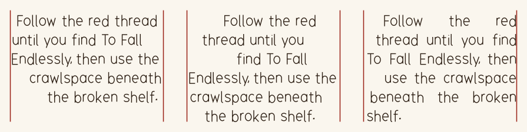

### `write_inside_path(text, path, settings)`

The text written inside a closed path, as a text box of that shape writes it: line by line, each glyph's ink wholly inside, with the type's glyph_scale and glyph_tracking, the paragraph's line_height (if set, lines at least that far apart; unset, spaced by their ink), layout (default flat), align, valign, angle, line_start_jitter, line_gap_jitter, overhang, clearance, splitting and breaking words, and the style's glyph jitters and baseline_wander. Each subpath of the path is an outline, closed back to its start; one inside another is a hole. Gives #{ canvas, rest }: the text written, and the text that didn't fit (blanks it starts with left off), or an empty string, so what's left can go on into the next path. With the paragraph's fit, the glyphs are set as big as they can be (to within a hundredth of their size), up to the glyph_scale, and still all fit, so rest is always empty; that fails if the text fits at no size.

| argument | what it does | takes |
|---|---|---|
| `text` | The text to write; marked up, its spans are set as it's written (see Marked-Up Text). | a string, or markdown(text). |
| `path` | Where it goes: the inside of its subpaths. | a path enclosing something: a subpath of at least three points. |

| option | default | what it does | takes |
|---|---|---|---|
| `settings.avoid` | nothing | What glyphs keep clear of (see Keeping Text Clear). | an avoidance tree, a path, a canvas, a glyph or image paint, or an array of any of these. |

```rhai render=write_inside_path
let ring = new_circle(vec2(90, 90), 85);
page.add(ring, RED_PEN);
page.add(write_inside_path("Lorem ipsum dolor sit amet, consectetur adipiscing elit, sed do eiusmod tempor incididunt ut labore et dolore magna aliqua. Ut enim ad minim veniam, quis nostrud exercitation.", ring, #{
	style: TEXT.style, type: new_type_style(PLAIN, 18), paragraph: #{ layout: "words", clearance: 6 },
}).canvas);
```

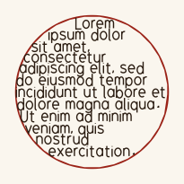

### `canvas.scatter_notes(messages, width_range, height_range, settings)`

Scatters messages over the canvas in random boxes, clear of its strokes and of each other; gives a canvas of just the messages. Each note's glyphs turn and scale by the hand's glyph_rotation_jitter and glyph_scale_jitter before notes are placed, and stray by its glyph_position_jitter after. Fails for an empty canvas.

| argument | what it does | takes |
|---|---|---|
| `messages` | The notes, a box each; marked-up ones set their spans (see Marked-Up Text). | an array of strings and markdown(text)s. |
| `width_range` | Box widths to try, at random between the two. | [least, most]: positive numbers, least at most most. |
| `height_range` | Box heights to try. | [least, most]: positive numbers, least at most most. |

| option | default | what it does | takes |
|---|---|---|---|
| `settings.max_attempts` | 100 | How many boxes are tried for each message before backing off. | a whole number of at least 1. |
| `settings.avoid` | nothing | What glyphs keep clear of, besides the canvas and other notes (see Keeping Text Clear). | an avoidance tree, a path, a canvas, a glyph or image paint, or an array of any of these. |

```rhai render=scatter_notes
let board = new_canvas().add(new_rectangle(vec2(150, 110), 300, 220), RED_PEN);
page.add(board);
page.add(board.scatter_notes(["lorem ipsum", "dolor sit", "amet", "consectetur"], [140, 180], [22, 26], #{
	style: TEXT.style, type: new_type_style(PLAIN, 20), paragraph: #{ clearance: 10, layout: "words" },
}));
```

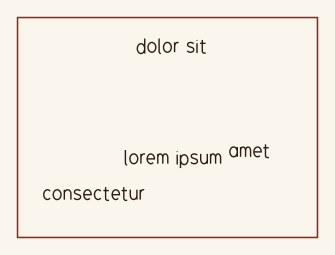

## Keeping Text Clear

avoid, in every text layout, is a tree, a path, a canvas, a glyph or image paint, or an array of any of these. Text whose style is in image paint that avoids colours keeps clear of those parts of the picture as well. Glyphs keep their whole outline (the hull of their strokes) at least the paragraph's clearance from all of it (3 canvas units unless it says), on top of any margin a tree was built with. Glyphs placed by one call keep clear of each other too.

### `new_avoidance_tree()`

An empty tree of what to keep clear of. Trees are shared: a text box made with one sees what's added to it later, so tree.add(placed) keeps later text off what's just been placed.

```rhai render=avoid
let disc = new_circle(vec2(250, 45), 45);
page.add(disc, RED_PEN);
page.add(write_block("Lorem ipsum dolor sit amet, consectetur adipiscing elit, sed do eiusmod tempor incididunt ut labore et dolore magna aliqua.", vec2(0, 0), 500, #{
	style: TEXT.style, type: TEXT.type, avoid: new_avoidance_tree().add(disc, #{ margin: 8 }),
}).canvas);
```

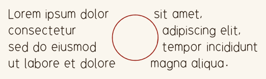

### `tree.add(item), tree.add(item, options)`

Adds what to keep clear of, as it is now. Returns the tree.

| argument | what it does | takes |
|---|---|---|
| `item` | What to keep clear of. | a path (its lines), a canvas (its marks), a glyph (its outline, insides included), another tree (with its own margins), image paint (the parts of the picture in the colours it avoids), or an array of any of these. |

| option | default | what it does | takes |
|---|---|---|---|
| `options.margin` | 0 | How far to keep from it, in canvas units, on top of the clearance text asks for. | a number of at least 0. |

### `tree.add_hull(item), tree.add_hull(item, options)`

Keeps out of everything inside the item's outline, not just off its marks. Returns the tree.

| argument | what it does | takes |
|---|---|---|
| `item` | What to take the outline of. | a path, a canvas or a glyph, or an array of any of these; not a tree. |

| option | default | what it does | takes |
|---|---|---|---|
| `options.margin` | 0 | How far to keep from the outline, in canvas units. | a number of at least 0. |

### `tree.add_region(path), tree.add_region(path, options)`

Keeps out of a closed shape. Returns the tree.

| argument | what it does | takes |
|---|---|---|
| `path` | The shape. | a path. |

| option | default | what it does | takes |
|---|---|---|---|
| `options.margin` | 0 | How far to keep from it, in canvas units. | a number of at least 0. |

### `tree.blocks(point), tree.blocks(glyph)`

Whether something is too close to what's in the tree.

| argument | what it does | takes |
|---|---|---|
| `point or glyph` | What to test. | a vec, or a placed glyph (a blank one is never blocked). |

### `tree.is_empty`

Read only: whether the tree holds nothing.

### `tree.copy()`

An independent copy of the tree.

### `free_regions(area, avoid), free_regions(area, avoid, options)`

The stroke-free space inside an area, as paths to write text into, largest first (see order): write_inside_path(text, region, settings) fills one, its rest going on into the next. The area is cut into a grid of square cells; a cell is free where its middle is inside the area and clear of what's avoided, and free cells joined side to side are one region. Each region is one path: its outline, then a subpath for each hole, outlines running half a cell from free cells' middles, so they keep inside the area and the clearance from what's avoided. Fails for a grid of more than four million cells.

| argument | what it does | takes |
|---|---|---|
| `area` | Where to look. | a path enclosing something, such as the page's rectangle. |
| `avoid` | What isn't free. | anything a text call's avoid takes: a path (its lines), a canvas (its marks' edges), a glyph, an avoidance tree, image paint, or an array of any of these. |

| option | default | what it does | takes |
|---|---|---|---|
| `options.clearance` | one resolution | How far outlines keep from what's avoided, in canvas units. | a number of at least 0. |
| `options.resolution` | the area's longer side over 400 | The cells' size: smaller follows strokes more closely, and takes longer. | a positive number. |
| `options.min_width` | 0 | Free space narrower than this is left out, and narrow necks part regions: each region grows from a core further than half this from anything, the nearer core taking what two could reach. | a number of at least 0. |
| `options.min_area` | four cells square | Regions with less room than this, holes taken away, are left out. | a number of at least 0. |
| `options.outline` | polygon | polygon: straight edges, the grid's outline thinned to the points it needs; smooth: curves through it, rounding the corners. | polygon or smooth. |
| `options.tolerance` | half a resolution | How far a polygon's edges may stray from the grid's outline. | a number of at least 0. |
| `options.order` | largest | Which regions come first, by the room they enclose (path.area()): largest or smallest. For any other order, sort the array with regions.sort(f), f taking two regions and giving true when the first goes first: comparing their bounds().min.y puts the highest first. | largest or smallest. |

### `free_regions_in_canvas(canvas), free_regions_in_canvas(canvas, options)`

free_regions in the canvas's bounds (its marks, strokes' widths included), avoiding the canvas: free_regions(rectangle, canvas, options), the rectangle being the bounds grown by the margin. Fails for an empty canvas, or a margin that shrinks the bounds to nothing.

| argument | what it does | takes |
|---|---|---|
| `canvas` | What to look round, and in. | a canvas with something on it. |

| option | default | what it does | takes |
|---|---|---|---|
| `options.margin` | vec2(0, 0) | How much further than the bounds to look, on each side: x left and right, y above and below. Negative looks only inside them, that far in. | a vec2. |
| `options.clearance`, `resolution`, `min_width`, `min_area`, `outline`, `tolerance`, `order` | as free_regions | As free_regions takes them. | as free_regions takes them. |

### `free_regions_in_page(page), free_regions_in_page(page, options)`

free_regions over the page as it's rendered, avoiding all its canvases: a page with a set size is the region from the origin to it; otherwise each canvas's bounds and margin, all of them together; a tile is its own part of the page. Fails for an empty page, or a margin that shrinks it to nothing.

| argument | what it does | takes |
|---|---|---|
| `page` | What to look over, and round. | a page with something on it, or a set size. |

| option | default | what it does | takes |
|---|---|---|---|
| `options.margin` | vec2(0, 0) | How much further than the page's edges to look, on each side: x left and right, y above and below. Negative keeps that far in from them. | a vec2. |
| `options.clearance`, `resolution`, `min_width`, `min_area`, `outline`, `tolerance`, `order` | as free_regions | As free_regions takes them. | as free_regions takes them. |

## Randomness and Messages

### `seed(n)`

Reseeds the generator that random, glyph variants, text layout and hatching draw on.

| argument | what it does | takes |
|---|---|---|
| `n` | Where the generator starts again: the same seed gives the same numbers after it. | a whole number. |

### `random()`

A decimal from 0 up to 1.

### `random_range(low, high)`

A number from low up to, not including, high.

| argument | what it does | takes |
|---|---|---|
| `low` | The least it can give. | a number. |
| `high` | What it stays below. Whole numbers at both ends give a whole number, and a decimal at either end gives a decimal. | a number above low. |

### `warn(message)`

Reports something, with the script line, without stopping the script. Errors give the script line too.

| argument | what it does | takes |
|---|---|---|
| `message` | What to report. | a string. |

### `assert(condition, message)`

Stops the script, with the message and the script line, unless the condition holds: for checking a journal's own sums.

| argument | what it does | takes |
|---|---|---|
| `condition` | What must hold. | true or false. |
| `message` | What went wrong, if it doesn't. | a string. |

## Generators

Points to draw from, and the trees that join them. Distributions and the depth_first and random trees draw on the script's generator, so seed(n) fixes them.

### `distribute_points(kind, count, bounds)`

Exactly count points scattered through a box, as an array of vec2s, vec3s or vec4s: as many coordinates as bounds has pairs.

| argument | what it does | takes |
|---|---|---|
| `kind` | How they're scattered. uniform_random: each anywhere, so clumps and gaps. poisson_disk: evenly at random, none close, by weighted sample elimination. jittered_grid: one at random in each of count cells of a grid. grid: the cells' centres, row by row, x fastest, every cell when count fills the grid. halton: the Halton sequence, quasi-random and even, shifted at random. golden: the generalised golden-ratio sequence, like halton but more even. | uniform_random, poisson_disk, jittered_grid, grid, halton or golden. |
| `count` | How many points. | a whole number from 0 to 1000000. |
| `bounds` | The box: the least and greatest each coordinate can be, x first. | an array of 2, 3 or 4 [low, high] pairs of numbers, low below high. |

```rhai render=distribute_points
page.add(new_rectangle(vec2(150, 80), 300, 160), RED_PEN);
for p in distribute_points("poisson_disk", 80, [[5, 295], [5, 155]]) {
	page.add(new_circle(p, 3), PEN);
}
```

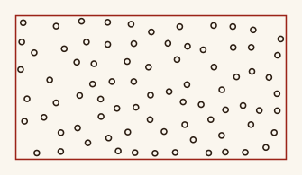

### `points.spanning_tree(), points.spanning_tree(options)`

A tree joining every point by one way only, as an array of [parent, child] index pairs into points, each pointing away from the root, in the order the algorithm added them: draw them in order and the tree grows. Every pair is compared, so at most 20000 points. Under 2 points gives [].

| argument | what it does | takes |
|---|---|---|
| `points` | What to join. | an array of vec2s, vec3s or vec4s, all one size. |

| option | default | what it does | takes |
|---|---|---|---|
| `options.algorithm` | prim | Which tree. prim (or minimum): the shortest in all, grown from the root a nearest point at a time. kruskal: the same tree, its edges shortest first, fragments joining up. maximum: the longest in all, long crossing lines. shortest_path: each point by its shortest way to the root, veins radiating out. breadth_first: by hops from the root, nearest neighbours first. depth_first: a random walk deep before it backtracks, long corridors. random: a uniformly random tree, an even maze. The last four go between neighbours only. | prim, minimum, kruskal, maximum, shortest_path, breadth_first, depth_first or random. |
| `options.metric` | euclidean | How far apart points are. euclidean: straight. squared_euclidean: straight, squared, the same minimum tree but shortest paths take many short hops. manhattan: along the axes, as streets in a grid. chebyshev: the farthest along any one axis. | euclidean (or euclidian), squared_euclidean, manhattan (or taxicab) or chebyshev. |
| `options.root` | 0 | The point the tree grows from. | a whole number, the index of a point. |
| `options.neighbours` | 4 per coordinate, less 2: 6 for vec2s | For the neighbour algorithms, how many nearest points each point is joined to (and they to it); the shortest tree's edges are added too, so it's in one piece. | a whole number of at least 1. |

```rhai render=spanning_tree
let points = distribute_points("poisson_disk", 60, [[0, 300], [0, 160]]);
page.add(new_edges(points, points.spanning_tree()), PEN);
for p in points {
	page.add(new_circle(p, 3), RED_PEN);
}
```

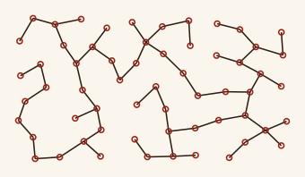

### `nearest(points, point)`

The index of the point nearest point: a root for a tree, say.

| argument | what it does | takes |
|---|---|---|
| `points` | Where to look. | a non-empty array of vecs, all one size. |
| `point` | What to be near. | a vec of the same size. |

### `new_edges(points, pairs)`

A path of straight lines, one between the two points each pair indexes: a spanning tree drawn.

| argument | what it does | takes |
|---|---|---|
| `points` | The points. | an array of vec2s. |
| `pairs` | Which to join. | an array of [a, b] indices into points, as spanning_tree gives. |

## Balanced Ternary

A balanced-ternary value is a number's digits, -1, 0 and 1, most significant first, each worth three times the next: 5 is +--, 9 - 3 - 1. It's a value: glyphsets draw it as a glyph and paths write it as marks.

### `balanced_ternary(n, options), balanced_ternary(text), balanced_ternary(digits)`

A balanced-ternary value: from a whole number, in as few digits as it needs (0 is 0) or at least options.width of them, or from its digits as given, leading 0s kept, as many as there are.

| argument | what it does | takes |
|---|---|---|
| `n` | The number. | a whole number. |
| `text` | The digits as text: - for -1, 0, and + for 1. | a non-empty string of -, 0 and +. |
| `digits` | The digits. | a non-empty array of -1, 0 and 1. |

| option | default | what it does | takes |
|---|---|---|---|
| `options.width` | 1 | The fewest digits: a shorter number is padded with 0s in front. balanced_ternary(5, #{ width: 5 }) is 00+--. | a whole number of at least 1. |

```rhai render=balanced_ternary
let ternary = glyphset("balanced_ternary");
for n in -13..=13 {
	page.add(ternary.glyph(balanced_ternary(n), #{ scale: 30, position: vec2((n + 13) * 40, 0) }), PEN);
}
```

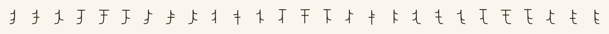

### `bt.value`

Read only: the whole number it is; an error for more digits than a whole number holds (over 39).

### `bt.digits()`

Its digits, an array of -1, 0 and 1.

### `bt.digits(width)`

Its digits in chunks of width, an array of arrays, the first padded with 0s in front so every chunk reads as a number: balanced_ternary(2026).digits(3) is [[0, 1, 0], [-1, 1, 0], [0, 0, 1]], 3, -6 and 1.

| argument | what it does | takes |
|---|---|---|
| `width` | Digits to a chunk. | a whole number of at least 1. |

### `bt.to_string(), bt.to_debug(), a == b, a != b`

Its digits as text, such as +--, for print and debug; and whether two values have the same digits.

### `path.fill_with_text(bt, settings)`

The digits written along the path from its start, as the balanced_ternary glyphset writes them down its stems, the type's glyph scale apart, over as many copies of the path as it takes: an array of canvases, one per copy. A 0 is a bar across the path, and a -1 or 1 a stroke that runs alongside the path for most of its slot, then bends sharply out to the left or right of a traveller going along the path (for a path running left to right across the page, 1 is down). The path must be one subpath, and isn't drawn.

| argument | what it does | takes |
|---|---|---|
| `bt` | The digits. | a balanced-ternary value. |

| option | default | what it does | takes |
|---|---|---|---|
| `settings.style` | default_style() | What the marks are drawn in. | a style, or a map of style settings. |
| `settings.type` | required | How far along the path each digit's slot runs: its glyph_scale. | a type style or a map with a glyph_scale no longer than the path. |
| `settings.width` | 0.6 of the slot | How far the marks reach out from the path. | a positive number. |

### `path.fit_text(bt, settings)`

The digits written along the whole path, each a share of its length, as a canvas; otherwise as above.

| argument | what it does | takes |
|---|---|---|
| `bt` | The digits. | a balanced-ternary value. |

| option | default | what it does | takes |
|---|---|---|---|
| `settings.style` | default_style() | What the marks are drawn in. | a style, or a map of style settings. |
| `settings.width` | 0.6 of the slot | How far the marks reach out from the path. | a positive number. |

## Procedural Art

The art module draws shapes from a few parameters and a seed of their own: the same seed gives the same drawing, and the script's generator is neither used nor changed.

### `art::snake(head_center, tail_end, length), art::snake(head_center, tail_end, length, options)`

A snake seen from above, winding from its head to the tip of its tail. Gives #{ outline, spine }: its outline, which is several strokes, since where it crosses itself the strand beneath stops at the edge of the one on top (the head always goes over); and its centre line, from the back of its head to the tip of its tail, a path to write along.

| argument | what it does | takes |
|---|---|---|
| `head_center` | Where the centre of its head is. | a vec. |
| `tail_end` | Where the tip of its tail is: near enough for a snake this long to reach. | a vec. |
| `length` | How long it is along its spine. | a number at least 4 times max_width. |

| option | default | what it does | takes |
|---|---|---|---|
| `options.head_angle` | facing away from the tail | Which way its head faces: 0 is +x, PI() / 2 down the page. | a number, in radians. |
| `options.max_width` | length / 12 | How wide it is at its widest. | a positive number. |
| `options.seed` | one from the generator | Which winding it draws: the same seed gives the same drawing, without touching the script's generator; left out, the journal's generator picks one. | a whole number. |

```rhai render=snake
page.add(art::snake(vec2(40, 60), vec2(300, 60), 600, #{ head_angle: 0, max_width: 32, seed: 5 }).outline, PEN);
```

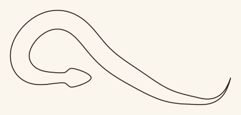

### `art::snake_along(path, max_width), art::snake_along(path, max_width, options)`

A many-headed serpent along a path, as a path: its body follows the path, slithering a little off it and forking where it forks, its tail at the dead end nearest the path's start and a head at every other.

| argument | what it does | takes |
|---|---|---|
| `path` | The lines its body follows. | a path with lines. |
| `max_width` | How wide it is at its widest. | a positive number. |

| option | default | what it does | takes |
|---|---|---|---|
| `options.seed` | one from the generator | Which serpent it draws: the same seed gives the same drawing, without touching the script's generator; left out, the journal's generator picks one. | a whole number. |

### `art::bramble(base, length), art::bramble(base, length, options)`

A blackberry bramble. Gives #{ vines, leaves, flowers }: canes, thorns and stalks; leaflets and veins; flowers, buds and sepals, as paths to stroke in different colours (canvas.add(parts, styles) draws them). Parts in front hide the lines behind them.

| argument | what it does | takes |
|---|---|---|
| `base` | Where the cane grows from. | a vec. |
| `length` | How far it grows. | a number at least 2 times flower_size. |

| option | default | what it does | takes |
|---|---|---|---|
| `options.angle` | -PI() / 2, up the page | Which way it grows: 0 is +x. | a number, in radians. |
| `options.flower_size` | length / 5 | About how wide its flowers are, which everything else is sized by. | a positive number. |
| `options.seed` | one from the generator | Which bramble it draws: the same seed gives the same drawing, without touching the script's generator; left out, the journal's generator picks one. | a whole number. |
| `options.origin` | none | A growth origin: canes and branches are thicker toward it, as old wood is. Thorns, stalks, leaves and flowers keep their size. Needed for thickness and reach. | a vec. |
| `options.thickness` | 3 | How many times their usual width canes and branches are at the origin, easing back to it at the reach. | a number of at least 1. |
| `options.reach` | as far as the cane could grow from the origin | How far from the origin canes and branches are back to their usual width. | a positive number. |

```rhai render=bramble
let plant = art::bramble(vec2(150, 300), 260, #{ flower_size: 50, seed: 4 });
page.add(plant.vines, PEN);
page.add(plant.leaves, PEN);
page.add(plant.flowers, RED_PEN);
```

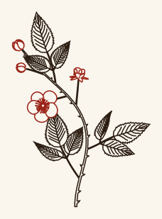

### `art::bramble_along(path, flower_size), art::bramble_along(path, flower_size, options)`

A bramble grown along a path, such as a maze's: vines follow its lines, branch at junctions and flower at its dead ends. Gives #{ vines, leaves, flowers }.

| argument | what it does | takes |
|---|---|---|
| `path` | The lines its vines follow. | a path with lines, all its points finite. |
| `flower_size` | About how wide its flowers are, which everything else is sized by. | a positive number. |

| option | default | what it does | takes |
|---|---|---|---|
| `options.seed` | one from the generator | Which bramble it draws: the same seed gives the same drawing, without touching the script's generator; left out, the journal's generator picks one. | a whole number. |
| `options.origin` | none | A growth origin: vines are thicker toward it, as old wood is. Thorns, stalks, leaves and flowers keep their size. Needed for thickness and reach. | a vec. |
| `options.thickness` | 3 | How many times their usual width vines are at the origin, easing back to it at the reach. | a number of at least 1. |
| `options.reach` | the farthest point of the path from the origin | How far from the origin vines are back to their usual width. | a positive number. |

### `art::eye(center, length), art::eye(center, length, options)`

An eye as a hand sketches one. Gives #{ lines, accent, wash, rim, iris_radius }: lines, the lids gone over and running past the corners, the iris ringed, and a line through the iris bowed toward where it looks; accent, a second outline of the lids, to go round in the iris's colour; wash, a spiral filling the iris; rim, rings round the iris's edge where its wash pools; and iris_radius, a number, to size the wash's brushes by (a third of it suits the wash, an eighth the rim). The iris's parts are hidden where the lids cover it. Draw the colour before the lines, part by part: canvas.add(parts, styles) draws in name order, which would put the wash over the lines.

| argument | what it does | takes |
|---|---|---|
| `center` | Its centre. | a vec. |
| `length` | How long it is from corner to corner. | a positive number. |

| option | default | what it does | takes |
|---|---|---|---|
| `options.gaze_angle` | 0 | Which way it looks, on the page: 0 is +x, -PI() / 2 up. | a number, in radians. |
| `options.gaze` | 0.5 | How far it looks toward gaze_angle: 0 straight ahead, 1 as far as it goes. | a number from 0 to 1. |
| `options.messiness` | 0.3 | From neat, each line drawn once, to as messy as it gets, lines gone over four or five times, wandering and overshooting. Neat lines are as few curves as their shape needs (a flat lid is two straight lines), so a style's point_jitter bends them whole; messier ones are drawn through more points, to wander. | a number from 0 to 1. |
| `options.seed` | one from the generator | Which eye it draws: the same seed gives the same drawing, without touching the script's generator; left out, the journal's generator picks one. | a whole number. |
| `options.angle` | 0 | The eye's tilt; 0 keeps the corners level. | a number, in radians. |
| `options.openness` | 0.32 | Its height over its length. | a number above 0.05 and at most 1. |
| `options.flat` | false | Lids of straight lines from each corner to a point above and below the middle, as the symbols glyphset's eye has, rather than arcs. | true or false. |

### `art::spiral_text(text, center, radius, settings)`

The text written in a spiral out from the middle of a circle, clockwise from the top, each glyph turned to the spiral (or held at the paragraph's angle), as large as all of it fits, as a canvas. Glyphs keep one size until they'd come nearer the circle than the paragraph's clearance; from there each fills the room left between the circle and the glyphs on the turn inside it, corners and all, shrinking as that narrows, and the spiral ends where they'd be smaller than minimum_scale of the rest. Turns are the paragraph's line height apart, measured in the height of the text's tallest glyph rather than in glyph scales, so 1 sets turns touching. Takes the type's glyphset, glyph_scale and glyph_tracking, the paragraph's layout (default flat), angle, line_height, clearance, splitting and breaking words, and the style. Fails if the text doesn't fit at any size.

| argument | what it does | takes |
|---|---|---|
| `text` | The text to write; marked up, its spans are set as it's written (see Marked-Up Text). | a string, or markdown(text). |
| `center` | The circle's centre. | a vec. |
| `radius` | The circle's radius: glyphs keep the clearance inside it. | a number bigger than the clearance. |

| option | default | what it does | takes |
|---|---|---|---|
| `settings.type.glyph_scale` | none: as large as fits | The largest glyphs are set; smaller if the text doesn't fit at it. | a positive number. |
| `settings.inner` | 0.85 of the glyph scale | How far from the centre the spiral starts. | a number of at least 0. |
| `settings.minimum_scale` | 1/3 | The smallest the outer turn's glyphs shrink to, as a fraction of the rest; 1 keeps them all one size. | a positive number, at most 1. |
| `settings.avoid` | nothing | What glyphs keep clear of (see Keeping Text Clear). | an avoidance tree, a path, a canvas, a glyph or image paint, or an array of any of these. |

```rhai render=spiral_text
let ring = new_circle(vec2(120, 120), 115);
page.add(ring, RED_PEN);
page.add(art::spiral_text("Lorem ipsum dolor sit amet, consectetur adipiscing elit, sed do eiusmod tempor incididunt ut labore et dolore magna aliqua.", vec2(120, 120), 115, #{ style: TEXT.style, type: #{ glyphset: PLAIN } }));
```

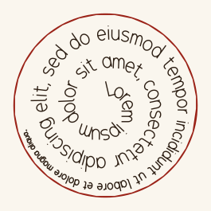

### `art::moon(center, radius, phase)`

The moon in a phase, seen from the northern hemisphere. Gives #{ outline, terminator, lit, dark }: the disc's outline; the terminator, the half ellipse from the top of the disc to the bottom between light and dark (an empty path at new and full); and the lit and dark sides as closed shapes, to hatch or fill (the lit side empty at new, the dark side at full). It takes no seed: the same phase draws the same moon.

| argument | what it does | takes |
|---|---|---|
| `center` | Its centre. | a vec. |
| `radius` | Its radius. | a positive number. |
| `phase` | How far through its month it is: 0 new, 0.25 first quarter (the right half lit), 0.5 full, 0.75 last quarter (the left half lit). Phases wrap, so 1.25 is 0.25 and -0.25 is 0.75. | a number. |

```rhai render=moon
for (phase, i) in [0.125, 0.25, 0.5, 0.75, 0.875] {
	let moon = art::moon(vec2(50 + i * 110, 50), 45, phase);
	page.add(moon, #{ outline: PEN, terminator: PEN });
	if !moon.dark.is_empty {
		page.add(moon.dark.hatch(5.0, #{ angle: 0.8 }), RED_PEN);
	}
}
```

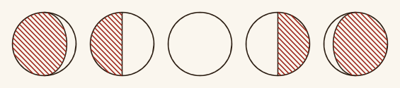

### `art::huffman_stars(symbols, output_base, center, width, height), art::huffman_stars(symbols, output_base, center, width, height, options)`

A star chart whose constellation is a Huffman tree: the code the huffman lock would build from the symbols, rewriting them in output_base (ties go to the lower symbol, so it is the lock's code exactly). Its nodes are stars, bigger the more often their symbols come up (a branch weighs its symbols together, so the root is biggest, the rarest symbols a third its size, on a log scale); its branches are the links, each one digit of the code. The tree is grown out from its root, near the middle, at random angles and lengths, each subtree looking for room, then tidied by forces: each star has a space of its own (stars nearer than their spaces push apart, and off the chart's edge), each link a length of its own (longer links pull together), and links push away stars that aren't theirs. Links never cross, and no link passes nearer a star than its radius and the gap. Gives #{ stars, links, points, edges, nodes }: stars, a circle for every star, and links, a line for every link stopping gap short of its stars, as paths (canvas.add(parts, styles) draws them); points, the stars' centres, and edges, [parent, child] index pairs into them, as new_edges takes; and nodes, a map for every star in the order of points, the root first then breadth first: position, its centre; radius; weight, how often its symbol comes up, smoothing included, or its leaves together; depth, 0 for the root; code, its digits from the root, an array of whole numbers (a leaf's is its symbol's code); symbol, a leaf's symbol, or () for a branch; text, that symbol as text (space for 0 in base 27), or (); and parent, its parent's index, or () for the root. Weightless leaves the lock pads merges with take digits but aren't stars.

| argument | what it does | takes |
|---|---|---|
| `symbols` | What to build the code from. | a lock value of symbols, as symbols(27, TEXT) gives; its base is the input base. |
| `output_base` | The base the code writes in: how many children a branch has, at most. | a whole number from 2 to 27. |
| `center` | The middle of the chart's box. | a vec. |
| `width` | How wide the box is: every star is wholly inside it. | a positive number. |
| `height` | How tall the box is. | a positive number. |

| option | default | what it does | takes |
|---|---|---|---|
| `options.smoothing` | 1 | As the lock's: how many times every symbol of the input base counts besides its uses, so with 1 every symbol is a star; with 0 only those used are. | a whole number of at least 0; with 0, symbols must not be empty. |
| `options.seed` | one from the generator | Which chart it draws: the same seed gives the same drawing, without touching the script's generator; left out, the journal's generator picks one. | a whole number. |
| `options.variation` | 0.6 | How much stars' spaces and pulls, links' lengths and the growth's reaches differ: 0 makes them all alike, 1 as uneven as they get. | a number from 0 to 1. |
| `options.iterations` | 150 | How many steps the forces tidy the grown tree by; 0 leaves it as grown. | a whole number from 0 to 10000. |
| `options.star_size` | a seventh of how far apart the stars spread evenly through the box would be | The biggest star's radius. | a positive number, less than half the box's width and height. |
| `options.gap` | star_size / 4 | How far short of stars links stop. | a number of at least 0. |
| `options.round` | false | Keeps the stars in the ellipse inscribed in the box rather than the box. | true or false. |

### `art::constellations(chart, count, center, width, height), art::constellations(chart, count, center, width, height, options)`

A chart's tree cut into constellations, a page each: pieces that hold together, neighbouring pieces sharing the star they meet at, so laid over each other on their shared stars they make the whole. The tree is cut leaves up into pieces of about the same number of links, as many as count or as near as the tree allows. Each piece is fitted, on its own, to the box, across and down apart (an affine stretch, so links still don't cross, neither way more than 4 times the other), so a cluster gets the room the box has its way, and each of its stars gets a spot for a label, clear of its links, its other stars and the labels placed before it, inside the box where it can be, a little toward the upper right all else equal. Gives an array of #{ stars, points, pairs, labels, scale }: stars, the chart's indices of the piece's stars, in order; points, where each goes in the box; pairs, its links as [parent, child] indices into points, as new_edges takes; labels, the middle of each star's label; and scale, how much the chart was scaled by to fit, a vec2: across and down.

| argument | what it does | takes |
|---|---|---|
| `chart` | The stars and links to cut. | a map with points (vec2s), edges ([parent, child] index pairs making one tree) and nodes (maps with a radius), as art::huffman_stars gives. |
| `count` | How many pieces. | a whole number of at least 1. |
| `center` | The middle of the box each piece is fitted to. | a vec. |
| `width` | How wide the box is. | a positive number. |
| `height` | How tall the box is. | a positive number. |

| option | default | what it does | takes |
|---|---|---|---|
| `options.label_width` | 30 | How wide a label's box is. | a number of at least 0. |
| `options.label_height` | 24 | How tall a label's box is. | a number of at least 0. |
| `options.label_gap` | 6 | How far from its star's edge a label sits, at least. | a number of at least 0. |
| `options.most_stars` | no limit | The most stars a constellation may have: the cut is the one nearest count pieces whose pieces all fit, so there are more pieces than count if that's what it takes (with count 1, as few as fit). | a whole number of at least 2. |
| `options.split_at` | [] | Stars whose constellation is split in two at them, one more piece each, both keeping the star: its branches from the star (the parts of it that meet only there) are taken round the star by the way they go, from the widest gap between them, and cut into two runs with about as many links each, so the pieces lie either side of it, the leftmost first. | an array of star indices, each with a constellation that has two or more branches from it. |

## Books

A book numbers pages in order and names them for their number and section, so their files sort in order, and keeps a contents of where each section starts. How a page looks, its running head and folio, is the journal's.

### `new_book(), new_book(options)`

An empty book.

| option | default | what it does | takes |
|---|---|---|---|
| `options.first` | 1 | As book.first. | as book.first. |

### `book.first = n`

The number the first page gets: 3, say, after a title page and a contents.

| argument | what it does | takes |
|---|---|---|
| `n` | The number. | a whole number; set before any page is added. |

### `book.add(section, page), book.add(section, pages)`

Adds a page, or pages in order, to a section, each named NN_SECTION: its number, two digits at least, and the section with spaces made underscores. Gives the (first) page's number.

| argument | what it does | takes |
|---|---|---|
| `section` | The section, as the contents lists it. | a string; a new section starts whenever it changes. |
| `page`, `pages` | What to add. | a page, or an array of pages such as typeset or split gives. |

### `book.next`

Read only: the number the next page added gets, for its folio.

### `book.pages`

Read only: the pages, in order, to add to journal_entry.

### `book.contents`

Read only: each section and its first page's number, [[section, number], ...].

### `roman(n)`

n in lowercase roman numerals, for folios: roman(14) is xiv.

| argument | what it does | takes |
|---|---|---|
| `n` | The number. | a whole number from 1 to 3999. |

### `escape_markdown(text)`

The text with markdown's marks escaped, so markdown(escape_markdown(text)) sets it as it is.

| argument | what it does | takes |
|---|---|---|
| `text` | The text. | a string. |

## Page Layouts

A layout describes pages as trees of flexbox boxes, and typeset pours text, art and ornaments into their slots, chaining text through columns and pages until it runs out. Typeset pages are named NAME_N and are exactly the layout's size; they split and go into PDFs like any page.

### `layout(name), layout(name, options)`

Loads a layout file, which defines page(n, info) and optionally options(), page_size(o) and example(); see Lock, Illustration, Layout and Style Files.

| argument | what it does | takes |
|---|---|---|
| `name` | Which file: layouts/NAME.rhai, the journal's or the library's. | a layout file's name without .rhai: no slashes, not starting with a dot. |

| option | default | what it does | takes |
|---|---|---|---|
| `options` | the file's defaults | Its options, which its pages see as info.options and page_size(o) as o. | a map of names its options() gives to values like their defaults: a whole number is fine for a number. |

### `new_layout(name, Fn(page_function))`

A layout from a function in the script.

| argument | what it does | takes |
|---|---|---|
| `name` | The layout's name, which its typeset pages are named after unless typeset says otherwise. | a string of letters, digits, underscores, hyphens and dots, not starting with a dot. |
| `page_function` | Gives each page's tree of boxes, given a page number and info, as a layout file's page(n, info) does. | a function pointer: Fn with the script function's name, as a string. |

### `layout.name`

Read only: the layout's name.

### `layout.typeset(options)`

Typesets pages until every flow has run out, giving them as an array. Fails, naming the flows, if a page sets none of what's left, or if text is left after max_pages.

| option | default | what it does | takes |
|---|---|---|---|
| `options.flows` | none | The text slots set, by flow name. A blank line starts a paragraph, and a line break breaks a line. | a map of names to strings or markdown(text). |
| `options.roles` | none | How each kind of text and stroke looks, by role name (see Roles). | a map of names to roles. |
| `options.art` | none | What figure and band slots draw, by name. | a map of names to canvases (drawn in their own styles), paths or glyphs (drawn in the slot's role style), or functions given the box, #{ x, y, width, height, center }, and giving a canvas or path, drawn as it comes. |
| `options.name` | the layout's name | What the pages are named after: NAME_0, NAME_1, and on. | a string of letters, digits, underscores, hyphens and dots, not starting with a dot. |
| `options.width` | the layout file's page_size() | The page width. Needed if the layout gives none. | a positive number. |
| `options.height` | the layout file's page_size() | The page height. Needed if the layout gives none. | a positive number. |
| `options.max_pages` | 200 | The most pages to set before failing. | a whole number of at least 1. |

Boxes. Every box takes an options map, which can be left out: its flex style, flex, and for slots (every box but rows and columns) the role it takes and a style, type, paragraph or spans of its own, each whole or a map of settings over its role's.

### `row(children), row(children, options)`

Lays out boxes across.

| argument | what it does | takes |
|---|---|---|
| `children` | The boxes it lays out, left to right. | an array of boxes: rows, columns, flows and the rest. |

| option | default | what it does | takes |
|---|---|---|---|
| `options.flex` | none | How the row is laid out, and where it sits (see Flex styles). | a flex style, or a map of flex settings, container settings among them. |

### `column(children), column(children, options)`

Lays out boxes down.

| argument | what it does | takes |
|---|---|---|
| `children` | The boxes it lays out, top to bottom. | an array of boxes. |

| option | default | what it does | takes |
|---|---|---|---|
| `options.flex` | none | How the column is laid out, and where it sits (see Flex styles). | a flex style, or a map of flex settings. |

### `flow(name), flow(name, options)`

A slot for text from a flow; what doesn't fit goes on in the next slot of the same name, then on the next page. Its role, unless options say one, is the flow's name.

| argument | what it does | takes |
|---|---|---|
| `name` | Which flow it sets. | a name in typeset's flows. |

| option | default | what it does | takes |
|---|---|---|---|
| `options` | none | Its flex style and slot settings (see Flex styles and Slots). | a map. |

### `label(text), label(text, options)`

Fixed text, such as a page number, in the role label unless options say another.

| argument | what it does | takes |
|---|---|---|
| `text` | The text it sets. | a string. |

| option | default | what it does | takes |
|---|---|---|---|
| `options` | none | Its flex style and slot settings. | a map. |

### `initial(name), initial(name, options)`

A drop cap: the next letter of a flow, filling its box, in the role initial unless options say another; that role needs a glyphset but no glyph scale. Placed absolutely in a column with the flow's slot, the text wraps round it.

| argument | what it does | takes |
|---|---|---|
| `name` | The flow whose next letter it draws. | a name in typeset's flows. |

| option | default | what it does | takes |
|---|---|---|---|
| `options` | none | Its flex style and slot settings. | a map. |

### `figure(name), figure(name, options)`

Art, fitted into the box, keeping its proportions, centred. A path or glyph is drawn in its role's style (the art's name unless options say another), or default_style() without one.

| argument | what it does | takes |
|---|---|---|
| `name` | Which art it draws. | a name in typeset's art. |

| option | default | what it does | takes |
|---|---|---|---|
| `options` | none | Its flex style and slot settings. | a map. |

### `band(name), band(name, options)`

Art repeated along the box as an ornamental strip, each copy scaled to the band's breadth and turned to run along it (or by its flex style's turn).

| argument | what it does | takes |
|---|---|---|
| `name` | Which art it repeats. | a name in typeset's art. |

| option | default | what it does | takes |
|---|---|---|---|
| `options` | none | Its flex style and slot settings. | a map. |

### `rule(), rule(options)`

A line along the middle of the box, the long way, in the role rule's style unless options say another role.

| option | default | what it does | takes |
|---|---|---|---|
| `options` | none | Its flex style and slot settings. | a map. |

### `spacer(), spacer(options)`

Nothing: room.

| option | default | what it does | takes |
|---|---|---|---|
| `options.flex` | none | Its flex style. | a flex style, or a map of flex settings. |

A page function gets n (from 0) and info: #{ flows, art, width, height }, flows saying how many characters of each are left and art which art was given, so a layout can change as the text runs out.

### `new_flex_style(), new_flex_style(options)`

A flex style: how a box is sized and placed, and lays out its children. Its settings are the options below, each also a property, flex.KEY = value, checked as the option is. Lengths are canvas units, a percentage of the parent as N%, or auto.

| option | default | what it does | takes |
|---|---|---|---|
| `options.width`, `options.height` | auto | The box's size; left out, a flow or label is sized to its text. | a length. |
| `options.min_width`, `options.min_height`, `options.max_width`, `options.max_height` | none | Limits on its size. | a length. |
| `options.grow` | 0 | How much of its parent's spare room it takes, shared out among its siblings by this; a box that grows with no size of its own grows from nothing. | a number of at least 0. |
| `options.shrink` | 1 | How much it gives up when its parent is too small, shared out likewise. | a number of at least 0. |
| `options.basis` | auto | Its size along its parent before growing and shrinking. | a length. |
| `options.margin` | 0 | Room outside it. | one length, [vertical, horizontal], [top, horizontal, bottom], [top, right, bottom, left] or #{ top, right, bottom, left }. |
| `options.padding` | 0 | Room inside it, round its children or what it draws. | as margin. |
| `options.position` | relative | Whether it's in its parent's flow. | relative, or absolute: out of the flow, placed by top, left, right and bottom, with text in its parent wrapping round it. |
| `options.top`, `options.left`, `options.right`, `options.bottom` | none | Where an absolute box sits, from its parent's edges. | a length. |
| `options.aspect` | none | Its width over its height. | a number of at least 0. |
| `options.align_self` | auto | Where it sits across its parent, over the parent's align. | auto, start, end, center or stretch. |
| `options.border` | none | What outlines the box. | a style, a map of style settings over default_style(), or a role's name (for layout files, which can't see the journal's styles): that role's style. |
| `options.gap` | 0 | Rows and columns only: room between children. | a number of at least 0. |
| `options.justify` | start | Rows and columns only: where children sit along it. | start, end, center, space_between, space_around or space_evenly. |
| `options.align` | stretch | Rows and columns only: where children sit across it. | start, end, center or stretch. |
| `options.align_content` | stretch | Rows and columns only: how lines of wrapped children share room across it. | start, end, center, stretch, space_between or space_around. |
| `options.wrap` | false | Rows and columns only: whether children wrap onto more lines. | true or false. |
| `options.text_wrap` | box when absolute, none otherwise | Slots only: what text wrapping round it keeps clear of. | box (its box), hull (the outline of what it draws) or none. |
| `options.turn` | following the band | Bands only: turns each copy this far instead; by default it's turned a quarter when the art runs the other way from the band. | a number, in radians. |

### `flex_style.width, .height, .min_width, .min_height, .max_width, .max_height, .grow, .shrink, .basis, .margin, .padding, .position, .top, .left, .right, .bottom, .aspect, .align_self, .border, .gap, .justify, .align, .align_content, .wrap, .text_wrap, .turn = value`

A flex style's settings as properties: each as new_flex_style takes it.

| argument | what it does | takes |
|---|---|---|
| `value` | The setting's value. | as the option takes it. |

Slots: the keys of a slot's options, besides flex.

| key | default | what it does | takes |
|---|---|---|---|
| `role` | named after the slot | The role it takes: by default its flow's or art's name, or label, initial or rule. | a role's name, in typeset's roles. |
| `style`, `type`, `paragraph` | the role's | Its own, over its role's. | a style, type style or paragraph style, or a map of their settings over the role's. |
| `spans` | the role's | Named spans of its own, over its role's (see Marked-Up Text). | a map of names to spans. |

Roles: the keys of each role in typeset's roles. Flows and labels need a type with a glyphset and glyph scale; initials a glyphset; rules, borders and art draw in the style.

| key | default | what it does | takes |
|---|---|---|---|
| `style` | default_style() | What the role's text and strokes are drawn in, and the hand that sets its glyphs. | a style, or a map of style settings over default_style(). |
| `type` | none | The role's glyphset, glyph scale and shaping (see Text). | a type style, or a map of type settings. |
| `paragraph` | the defaults | How the role's lines are built and set (see Text): line_height, align, valign, indent, paragraph_gap, fit, clearance, line_start_jitter, line_gap_jitter, split_words, split_padding and break_words. | a paragraph style, or a map of paragraph settings. |
| `spans` | em and strong as Marked-Up Text says | The role's named spans. | a map of names to spans. |

## Marked-Up Text

### `markdown(text), markdown(text, options)`

Text styled as it's set, for a layout's flows and every text call, wherever they take a string: write_line, write_block, write_inside_path, path.fill_with_text, path.fit_text, art::spiral_text and canvas.scatter_notes. Spans nest, each changing what it's in; a text call's settings.spans names spans as a role's spans do. Plain text draws as it always has.

| argument | what it does | takes |
|---|---|---|
| `text` | The text, with its marks: `*emphasis*` or `_emphasis_` is the span em; `**strong**` or `__strong__` the span strong; `~~text~~` the span struck; `[text]{settings}` is set with settings of its own: span names, and key: value pairs, separated by commas, a key alone meaning true. A word alone is a setting if it's one, and a span's name otherwise; the spans named are applied first, then the settings. A backslash writes a mark as it is. | a string. |

| option | default | what it does | takes |
|---|---|---|---|
| `options.spans` | none | Named spans of the text's own, over its role's. | a map of names to spans. |

```rhai render=markdown
let warn = #{ warn: #{ style: #{ color: RED, passes: 2, pass_end_jitter: 1.2 } } };
page.add(write_block(markdown("Lorem _ipsum_ **dolor** [sit]{color: #9b2318} [amet]{underline}, ~~consectetur~~ [adipiscing]{warn} elit."), vec2(0, 0), 600, #{
	style: TEXT.style, type: TEXT.type, spans: warn,
}).canvas);
```

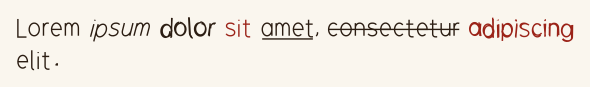

A span: a style and a type, each whole or a map of settings over the text it's in. em is by default #{ type: #{ italic: true } }, strong #{ style: #{ passes: 2, pass_end_jitter: 1.3 } }: gone over twice, a little astray, and struck #{ type: #{ strike: true } }: a line through; struck: #{ type: #{ strike: scribble } } scribbles out what `~~` marks.

| key | default | what it does | takes |
|---|---|---|---|
| `style` | the text's | What it's drawn in. | a style, or a map of style settings. |
| `type` | the text's | How it's set: a glyph_scale_factor multiplies the size of the text round it, and underline and strike draw lines under and through it. | a type style, or a map of type settings. |

Settings in a span's braces are a style's and a type's: color, passes, pass_end_jitter and the rest; italic, skew, glyph_scale_factor, glyph_outline_gap, space_width, underline and strike. Lines take true, false (none, inside text that has them), a number of lines, or {count, spacing, style}, the style in braces too; a strike also takes kind, or a kind's name alone: `[text]{strike: blot}`.

## Locks

Locks encipher text for a journal to draw. A chain is lock types wired together, each from a lock file in locks/; running it locks the text, and unlock recovers it. Locks and their values are named ID.NAME: the id a lock was added under, and the name its lock file gives the value.

### `new_lock(name)`

An empty lock chain. The chain is checked after every change, so a mistake fails at the line that made it.

| argument | what it does | takes |
|---|---|---|
| `name` | The chain's name, for messages. | a string. |

### `chain(name), chain(name, options)`

The chain a chain file, chains/NAME.rhai, describes: its locks added, wired and given their fixed values, and its illustrations attached and wired, as new_lock and its calls would build it, so its values are named ID.NAME and more can be added or attached. The web editor's lock editor makes chain files, and as it edits one, journals using it follow along.

| argument | what it does | takes |
|---|---|---|
| `name` | Which chain file: chains/NAME.rhai, the journal's or the library's. | a chain file's name (see Lock, Illustration, Layout and Style Files). |

| option | default | what it does | takes |
|---|---|---|---|
| `options` | the chain file's defaults | Its options, as its options() declares them. | a map of its option names to values, each required unless it has a default. |

### `lock.add(id, lock_type), lock.add(id, lock_type, options)`

Adds a lock to the chain. Returns the chain.

| argument | what it does | takes |
|---|---|---|
| `id` | The lock's name in the chain, as in ID.NAME. | a string, not empty, with no dot, that no other lock in the chain has. |
| `lock_type` | Which lock file: locks/TYPE.rhai, the journal's or the library's. | a lock type's name (see Lock types). |

| option | default | what it does | takes |
|---|---|---|---|
| `options` | none | The type's options. | a map of the type's option names to values: each required unless the type gives it a default. |

### `lock.connect(from, to)`

Wires one lock's output to another's input, or a value of the chain to an attached illustration's input. Returns the chain.

| argument | what it does | takes |
|---|---|---|
| `from` | The output, or for an illustration any value of the chain. | ID.NAME of a lock's output; for an illustration, of any lock's input or output. |
| `to` | The input it feeds. | ID.NAME of an input not already wired, of the output's type (or Any), making no loop; or ID.NAME of an illustration's input, of the value's type, not already wired. An illustration's wire leaves the chain as it was: the value is still an output, or still needs its input. |

### `lock.set_input(input, value)`

Fixes an input, so running doesn't need it. Returns the chain.

| argument | what it does | takes |
|---|---|---|
| `input` | The input. | ID.NAME of an input not wired to an output. |
| `value` | Its value. | a lock value of the input's type, as symbols(27, TEXT) gives, a string for a String input, or a value kind's data, as huffman::code gives (checked against the kind's shape). |

### `lock.attach(id, illustration), lock.attach(id, illustration, options)`

Attaches an illustration, an illustrations/TYPE.rhai file drawing the values wired to its inputs with lock.connect as canvases, which result.canvases gives. It runs in the journal's engine, not the lock's: locking and unlocking never see it. Returns the chain.

| argument | what it does | takes |
|---|---|---|
| `id` | The illustration's name in the chain, as in ID.NAME for its inputs. | a string, not empty, with no dot, that no lock or illustration in the chain has. |
| `illustration` | Which illustration file: illustrations/TYPE.rhai, the journal's or the library's. | an illustration type's name (see Illustrations). |

| option | default | what it does | takes |
|---|---|---|---|
| `options` | the illustration's defaults | Its options. | a map of names its options() gives to values like their defaults: a whole number is fine for a number. |

### `lock.source(id, kind, name), lock.source(id, kind, name, options)`

Adds a source: a journal file the chain draws on, its value at port ID.value, which lock.connect wires as a lock's output is. Content is data, so it can feed a lock's input (its value fixed there) or an illustration's; a style, glyphset or layout only an illustration's, at an input typed TextStyle, Glyphset or Layout, made when the illustration draws (text_style(name, options), glyphset(name), layout(name, options)). Returns the chain.

| argument | what it does | takes |
|---|---|---|
| `id` | Its name in the chain. | a string, not empty, with no dot, that no lock, illustration or source in the chain has. |
| `kind` | What it draws on. | content, style, glyphset or layout. |
| `name` | Which file. | a content, text style, glyphset or layout name. |

| option | default | what it does | takes |
|---|---|---|---|
| `options.options` | the file's defaults | A style's or layout's options. | a map. |
| `options.base` | none | Content only: text content (.txt, .md) as symbols in this base, what doesn't fit dropped; without it, text is a String. A .json content file's symbols are in its own base; a .graph file is a Graph, and takes none. | a whole number from 2 to 27. |

### `lock.illustrations()`

Every illustration attached, a chain file's included: #{ ID: illustration type }.

### `lock.inputs()`

The inputs still needing a value when it's run: #{ NAME: type }.

### `lock.outputs()`

The chain's final outputs: #{ NAME: type }.

### `lock.run(), lock.run(inputs)`

Runs the chain: a lock result of its outputs.

| option | default | what it does | takes |
|---|---|---|---|
| `inputs` | none, for a chain whose inputs are all set | A value for every open input. | a map of the names lock.inputs() gives to lock values of their types, strings for String inputs, or value kinds' data. |

### `lock.unlock(result)`

Recovers the inputs from a run's result: a lock result.

| argument | what it does | takes |
|---|---|---|
| `result` | What running the chain gave. | a lock result, from run. |

### `lock.unlock(outputs)`

Recovers the inputs from outputs given by hand: a lock result.

| argument | what it does | takes |
|---|---|---|
| `outputs` | The chain's outputs. | a map of the names lock.outputs() gives to lock values, strings or value kinds' data. |

### `result.get(name)`

One value, as a lock value.

| argument | what it does | takes |
|---|---|---|
| `name` | Which value. | one of the result's names, as values() lists them. |

### `result.text(name)`

One value as text.

| argument | what it does | takes |
|---|---|---|
| `name` | Which value. | one of the result's names, symbols or a string. |

### `result.values()`

Every value: #{ NAME: lock value }.

### `result.trace()`

Every value computed along the way, intermediate ones included.

### `result.canvases(id)`

What an attached illustration draws of this result's values: an array of canvases, one or more, to add to pages.

| argument | what it does | takes |
|---|---|---|
| `id` | Which illustration. | an id lock.illustrations() gives, every input of it connected. |

### `illustration(name), illustration(name, options)`

An illustration file, illustrations/TYPE.rhai, on its own, with no chain: illustration.run draws it. It runs in the journal's engine, so entries and layout, style and illustration files can call this, and lock and chain files can't.

| argument | what it does | takes |
|---|---|---|
| `name` | Which illustration file: illustrations/TYPE.rhai, the journal's or the library's. | an illustration type's name (see Illustrations). |

| option | default | what it does | takes |
|---|---|---|---|
| `options` | the illustration's defaults | Its options. | a map of names its options() gives to values like their defaults: a whole number is fine for a number. |

```rhai render=illustration
page.add(illustration("symbol_ring", #{ base: 7, step: 3, size: 300.0 }).run()[0]);
```

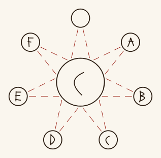

### `illustration.inputs()`

The values it draws, with the options illustration(name, options) gave it: #{ NAME: type }.

### `illustration.run(), illustration.run(inputs), illustration.run(inputs, options)`

Draws it: an array of canvases, one or more, to add to pages, as result.canvases gives.

| option | default | what it does | takes |
|---|---|---|---|
| `inputs` | none, for an illustration whose inputs all have fallbacks | The values it draws. An input left out takes its fallbacks(o); one with no fallback must be given. | a map of its input names to values of their types: lock values, as symbols(27, TEXT) or result.get(name) gives; values as lock files write them, symbols as arrays of whole numbers and value kinds' data as maps; strings for String inputs; and text_style(name), glyphset(name) or layout(name) for TextStyle, Glyphset or Layout inputs. |
| `options` | none | Options for this run alone, over what illustration(name, options) gave. The inputs it takes follow them. | a map of names its options() gives to values like their defaults: a whole number is fine for a number. |

### `symbols(base, text), symbols(base, text, options)`

Text as a lock value of symbols in a base.

| argument | what it does | takes |
|---|---|---|
| `base` | Which symbols: 10 is digits; 27 is space (0) and A to Z (1 to 26); other bases the first base letters, A being 0. | a whole number from 2 to 27. |
| `text` | The text. | a string of the base's symbols, letters in any case. |

| option | default | what it does | takes |
|---|---|---|---|
| `options.lenient` | false | Makes any text fit: in capitals, characters the base hasn't dropped, and runs of spaces and dashes one space where the base has one (not at either end). | true or false. |

### `value.symbols()`

The value's symbols, as an array of whole numbers. Fails for values that aren't symbols.

### `value.text()`

The value as text, for symbols and strings.

### `value.base`

Read only: the base of a value of symbols.

### `value.value()`

The value as lock files see it: symbols as an array of whole numbers, a value kind's (a maze, a code, a star chart) as its map of plain data.

### `value.type_name`

Read only: the value's type, such as Base27Symbol, Maze or StarChart.

### `value.maze()`

A maze output's data, a Maze map, for maze.cells() and maze.path(). Fails for values that aren't mazes.

### `value.sketch()`

A value kind's default drawing, as art::sketch draws its data. Fails for values that aren't a value kind's, or whose kind has no sketch.

### `value.to_string(), value.to_debug()`

The value as text, for print and debug.

### `new_maze(width, height), new_maze(width, height, options)`

A maze of width by height nodes, in a grid of 2w - 1 by 2h - 1 cells, as a Maze value (see Value Kinds). Its corridors depend only on the seed and size; its cells hold random symbols from 0 to 26, from the seed.

| argument | what it does | takes |
|---|---|---|
| `width` | How many nodes across. | a whole number of at least 1. |
| `height` | How many nodes down. | a whole number of at least 1. |

| option | default | what it does | takes |
|---|---|---|---|
| `options.seed` | 0 | Which maze. | a whole number. |
| `options.strategy` | LeftHanded | The order its cells are walked in. | LeftHanded or RightHanded. |

```rhai render=maze
page.add(new_maze(8, 3, #{ seed: 4 }).path().scale_by(30), PEN);
```

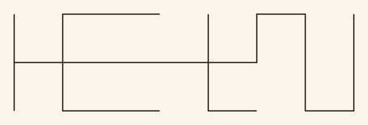

### `maze.width, maze.height`

Its grid size in cells, passages included: fields of its data.

### `maze.cells()`

Every cell in walking order, the order a lock writes its text: #{ x, y, step, symbol }. Nodes are at even coordinates, passages between them.

### `maze.fill(symbols)`

Writes symbols into the cells in walking order, and 0 into any left over: its symbols field, rewritten.

| argument | what it does | takes |
|---|---|---|
| `symbols` | What to write. | an array of whole numbers of at least 0, no more of them than the maze has cells. |

### `maze.path()`

A path along its corridors, in grid units, walked in the same order.

Lock types: the files in locks/, with the options lock.add gives them and the values they take and give.

| key | what it does | takes |
|---|---|---|
| `doublering` | The 26 letters in two rings of 13, each swapping with the one across; locking and unlocking are the same. Takes plain_text, gives cipher_text, both base 26. | options: canonical_order (required), the rings: a string of the 26 letters, each once. |
| `huffman_encode` | Text rewritten from input_base to output_base by the Huffman code its own symbols build, as huffman::code(plain_text, input_base, output_base) builds it. Takes plain_text (in input_base); gives cipher_text (in output_base) and code, a HuffmanCode: the key, which unlocking reads the cipher text back with and an art node such as star_chart can show. | options: input_base and output_base (required), whole numbers from 2 to 27; smoothing (optional, default 1), a whole number of at least 0, how many times every symbol counts besides its uses, as huffman::code takes it. |
| `huffman_apply` | Text rewritten from input_base to output_base by a Huffman code given as its tree, a HuffmanCode: one huffman_encode gives, or huffman::code builds from a corpus, so a message can be locked with another text's code. Takes plain_text (in input_base) and code; gives cipher_text (in output_base) and code, passed through: the key, which unlocking reads the cipher text back with. | options: input_base and output_base (required), whole numbers from 2 to 27, the code's own. |
| `huffman` | A Huffman code built from a corpus: symbols common in it get short codes, rare ones long, rewriting text from input_base to output_base. Ties go to the lower symbol, so a corpus always gives the same code. Takes corpus and plain_text, both in input_base; gives cipher_text, in output_base, and corpus, which unlocking rebuilds the code from. | options: input_base and output_base (required), whole numbers from 2 to 27; smoothing (optional, default 1), a whole number of at least 0, how many times every symbol counts besides its uses in the corpus. With smoothing 0, a symbol the corpus lacks has no code, and locking text with one fails. |
| `keyed_doublering` | A doublering whose order is an input. Takes plain_text and base_ordering, gives cipher_text and base_ordering, in the base. | options: base (required), an even whole number. |
| `maze_lock` | The text written into a square maze's cells, one symbol each, in walking order, the maze laid out by the seed. Takes maze_text (in input_base) and random_seed (base 10); gives generated_maze, random_seed and text_length. | options: input_base (required), a whole number from 2 to 27; strategy (optional, default LeftHanded), LeftHanded or RightHanded. |
| `shift_cipher` | Every symbol moved shift places along the base, wrapping round (a Caesar cipher). Takes plain_text, gives cipher_text. | options: base (required), a whole number from 2 to 27; shift (required), a whole number, negative moving the other way. |
| `shift_vigenere` | The key shifted along the alphabet, then used as a Vigenere key; a composite of shift_cipher and vigenere_cipher, base 27. Takes key and plain_text, gives cipher_text and shifted_key. | options: shift (optional, default 3), a whole number. |
| `star_chart` | An art node: a HuffmanCode drawn as a StarChart, every node a named star, every link carrying its digit, the sky cut into constellations of at most most_stars stars, a page each, every one fitted to its page; neighbouring pages share a star under the same name. The root is Shiathri, a letter's star is named for its letter (the space's, in base 27, Vacii). Unlocking reads only what the pages show: it joins them on their shared names, takes the root as the star no link points to, a leaf's symbol from its name's first letter and each digit from its link. Takes code, gives chart. | options: input_base and output_base (required), the code's (input_base 27 or a base of letters, 2 to 26 but not 10); most_stars (default 9), at least 2; seed (7), the sky's shape; name_seed (11), the names; size_seed (29), the stars' sizes; star_size (22), the biggest star's radius as it's laid out; width and height (1000 and 860), each page's sky; label_size (24), the size each star's number is written at (star_pages' digit_style's), its label given room 1.1 of that across and 1.4 down; label_gap (14), the label's distance from the star, as art::constellations takes it. |
| `substitution_cipher` | Each symbol replaced by the ordering's symbol at its position. Takes plain_text and ordering (every symbol of the base once), gives cipher_text and ordering. | options: base_n (required), a whole number from 2 to 27. |
| `vigenere_cipher` | Each plain symbol plus the key symbol under it, the key repeating, mod cipher_base. Takes plain_text and key, gives cipher_text and key. | options: plain_base, key_base and cipher_base (all required), whole numbers from 2 to 27. |

Helper types: the files in helpers/, lock files that transform data between locks rather than lock it. They're written, added with lock.add and wired as lock types are; a name is looked up in locks/ first.

| key | what it does | takes |
|---|---|---|
| `merge_alpha` | Texts joined end to end. Takes input_0 to input_N, gives merged_output and location_info, which unlocking splits them by. | options: base_n (required), a whole number from 2 to 27; input_count (required), a whole number of at least 1. |
| `split_symbols` | A text cut into pieces each as long as the first, the last ones shorter or empty. Takes plain_text, gives output_0 to output_N. | options: base_n (required), a whole number from 2 to 27; output_count (required), a whole number of at least 1. |
| `string_to_symbols` | A string read as symbols in the base, made to fit it first as symbols' lenient option makes it: in capitals, what the base can't write dropped. Takes text, a String; gives symbols, in the base. Unlocking writes the symbols back out as text, the text as it was fitted. | options: base (required), a whole number from 2 to 27; strict (optional, default false), true or false: the text must be written in the base already, as symbols(base, text) reads it, and text the base can't write is an error. |
| `symbols_to_string` | Symbols written out as a string, a letter each: in bases up to 26 the base's first letters, A for 0 (base 10 too, A to J, not digits as symbol_text writes it); in base 27 a space for 0, then A to Z. Takes symbols, in the base; gives text, a String. Unlocking reads the string back, its letters in either case; a character the base hasn't is an error. | options: base (required), a whole number from 2 to 27. |

## Value Kinds

A value kind is a lock value type whose values are plain data, maps of arrays, numbers and strings tagged with kind, so they cross between journals, lock files and the web editor as they are. Each is checked against its shape wherever it goes into or comes out of a lock, with errors naming the field; a kind's value holds only what its drawing shows. Its functions are the same in journals and lock files, and its sketch, if it has one, is how value.sketch, art::sketch and the editor draw it.

The kinds and their data.

| key | what it does | takes |
|---|---|---|
| `HuffmanCode` | An M-ary Huffman code as its tree: #{ kind, input_base, output_base, nodes }, nodes an array of #{ parent, digit, symbol }, the root first (its parent and digit ()), then breadth first, each node's children in digit order; a leaf's symbol is the input symbol its digits from the root encode, a branch's (). | sketch: the tree, top down, each leaf's symbol under it. |
| `Maze` | A maze: #{ kind, width, height, seed, strategy, symbols }: its grid in cells (odd), the seed its corridors come from, the order (LeftHanded or RightHanded) its cells are walked in, and each cell's symbol in that order. | sketch: the corridors, and each cell's symbol as a letter. |
| `Graph` | Places and the ways between them: #{ kind, nodes, edges }, each node #{ name, glyphs, glyphset } (its name, marked-up text, unique and not empty; the names of glyphs that go with it; and the glyphset they're from, or () for the drawing's own, as graph_map's glyph_style gives it) and each edge #{ from, to, directed, text } (the two different nodes it joins, by index, one way or both, and its text, marked up, "" for none). A .graph content file is one. | sketch: each place a ring for each of its glyphs, or a dot, its name boxed beside it, the ways' lines, arrowheads on the one-way ones, and their texts. |
| `StarChart` | A sky of named stars over pages, as it's drawn: #{ kind, input_base, output_base, pages }, each page #{ name, stars, links }: its stars #{ name, point, size, label } (where it is, how far its mark reaches, where its label goes, points as [x, y]), and its links [parent, child, digit], indices into its stars. A star on more than one page has the same name on each. | sketch: the pages in a grid, each star a ring, its links, its number at its label and the page's name over it. |

### `huffman::code(symbols, output_base), huffman::code(symbols, output_base, options), huffman::code(symbols, input_base, output_base), huffman::code(symbols, input_base, output_base, options)`

The HuffmanCode of a corpus, as the huffman lock builds its code: symbols common in it get short codes. In journals symbols is a symbols(...) value, its base the input base (given too, as lock files write it, it must match); in lock files it's an array and its base is given. The lock editor takes this as a test value.

| argument | what it does | takes |
|---|---|---|
| `symbols` | The corpus. | a symbols(base, text) value, or an array of whole numbers from 0 to input_base - 1. |
| `input_base` | With an array: its base. | a whole number from 2 to 27. |
| `output_base` | The base the code writes in: how many children a branch has, at most. | a whole number from 2 to 27. |

| option | default | what it does | takes |
|---|---|---|---|
| `options.smoothing` | 1 | How many times every symbol of the input base counts besides its uses: with 1 every symbol has a code. | a whole number of at least 0. |

### `stars::layout(code), stars::layout(code, options)`

A HuffmanCode's tree laid out as art::huffman_stars lays out its stars: grown from the root at random angles and lengths, then tidied by forces, links never crossing. Its stars are sized by depth, the root biggest, the deepest a third its size. Gives #{ points, sizes }, a [x, y] point and a radius for each node, in the code's order.

| argument | what it does | takes |
|---|---|---|
| `code` | The tree. | a HuffmanCode. |

| option | default | what it does | takes |
|---|---|---|---|
| `options.seed` | 0 | Which layout. | a whole number. |
| `options.variation` | 0.6 | As art::huffman_stars's. | a number from 0 to 1. |
| `options.iterations` | 150 | As art::huffman_stars's. | a whole number from 0 to 10000. |
| `options.star_size` | a seventh of how far apart the stars spread evenly would be | The root's radius. | a positive number. |
| `options.width`, `options.height` | 1000 and 800 | The box it's laid out in, from (0, 0); only its proportions matter once stars::split fits each piece. | positive numbers. |

### `stars::split(points, edges, sizes), stars::split(points, edges, sizes, options)`

A laid-out tree cut into constellations, as art::constellations cuts a chart: pieces sharing the stars they meet at, each fitted to the box from (0, 0) to (width, height), each star given a spot for its label. Gives an array of #{ stars, points, labels, pairs }, as art::constellations's pieces, points as [x, y].

| argument | what it does | takes |
|---|---|---|
| `points` | Where each star is. | an array of [x, y] points. |
| `edges` | The links, [parent, child] indices into points, making one tree. | an array of pairs. |
| `sizes` | How far each star's mark reaches, which links and labels keep clear of. | an array of numbers. |

| option | default | what it does | takes |
|---|---|---|---|
| `options.count` | 1 | As art::constellations's count. | a whole number of at least 1. |
| `options.most_stars`, `options.split_at` | no limit, [] | As art::constellations's. | as there. |
| `options.width`, `options.height` | 1000 and 860 | The box. | positive numbers. |
| `options.label_width`, `options.label_height`, `options.label_gap` | 30, 24 and 6 | As art::constellations's. | numbers of at least 0. |

Illustrations: the files in illustrations/, with the options lock.attach or illustration(name, options) gives them and the values they draw.

| key | what it does | takes |
|---|---|---|
| `eye` | An eye stood on end, its corners top and bottom: one text's symbols round its iris as balanced-ternary glyphs, clockwise from the top, and another's filling its pupil, as large as they fit; each symbol shifted to sit round 0. One canvas, width across and length down. Draws outer, symbols in outer_base, round the iris, and inner, symbols in inner_base, in the pupil; Welcome Home's eye holds a substitution cipher's ordering and cipher text. Drawn in lid_style, ring_style, iris_style and pupil_style, TextStyles, each whole: the iris's and pupil's glyphs are their types' glyphsets' (whose A to M and N to Z are 1 to 13 and -13 to -1), the iris's at iris_style's size or smaller if the ring hasn't room, the pupil's as large as all of it fits up to pupil_style's size, each glyph set off true by its hand's glyph jitter. Unwired, rough ink pens inked as its options say and balanced ternary. | options: outer_base and inner_base (27 and 27), whole numbers from 2 to 27; length and width (1640 and 717.2), the eye's size; top_ink and bottom_ink (#09603d and #0b2a1c), its lines' gradient, top to bottom; inner_ink (#000000), the pupil's glyphs; pupil_size (40), the pupil's glyphs' size unwired; pupil (lines), how the pupil's text goes: lines, across it line under line, justified and centred, or spiral, round and round out from its middle as art::spiral_text writes it; pupil_minimum_scale (0.33), with pupil spiral, the smallest its last turn's glyphs shrink to, as a fraction of the rest. |
| `maze_glyphs` | A Maze on a grid, cell by cell: its corridors in one style and each cell's symbol (0 to 26) in another. One canvas. Draws maze, a Maze, in corridor_style and glyph_style, TextStyles, each whole: the glyphs are glyph_style's glyphset's at its size, or smaller if a cell hasn't room (0.8 of one), leant as it leans them; in balanced-ternary digits, a symbol is its digit shifted to sit round 0, in any other glyphset its letter (0 a space, 1 to 26 A to Z). Unwired, ink pens in the corridors and glyphs inks and balanced ternary as big as the cells hold. | options: cell (70), a cell's size; corridors and glyphs (#9b2318 and #2b1d12), the inks of the styles' fallbacks. |
| `star_pages` | A StarChart page by page, a canvas each, page-sized: its constellation's name over it, each star's mark, each link's digit in balanced-ternary marks, each star numbered on its page at its label, and an index of the numbers to the names in the bottom right corner; leaves in red. Draws chart, a StarChart, in heading_style (the name, the index's heading at 0.64 of its size, the rule), line_style (links and stars, the marks reaching its glyph scale), leaf_style, digit_style (the numbers, in the index at 0.9 of its size: in balanced-ternary digits a glyph to three trits, in any other glyphset decimal), name_style and leaf_name_style, TextStyles, each whole; the index is spaced by the numbers' and names' sizes. Unwired, near-black and red ink pens, the heading in loche_upper, the numbers in balanced_ternary and the names in plain, at the sizes its options say. The star_chart's label_size should be digit_style's size. | options: width and height (1200 and 1600), the canvas; sky_x and sky_y (100 and 180), where the chart's sky starts; large_star (33), the size from which a star takes large_shape rather than small_shape; large_shape and small_shape (corona and rayed), each one of celestial, corona, orrery, rayed, sparkle or star (anything else a disc); heading_size, digit_size and name_size (44, 24 and 22), the unwired heading's, numbers' and names' sizes; index_x and index_y (600 and 1110), where the name index starts. |
| `symbol_ring` | A base's symbols in a ring, clockwise from the top, each joined by a dashed line to the symbol step on from it, round and round (base 5, step 2 is a five-pointed star; where base and step share a factor, a figure for each cycle), and in the middle the step's symbol. With bordered, each symbol round the ring is ringed and the dashes run from border to border; with center_bordered, the middle's is; the dashes stop short of the middle's symbol. One canvas, size across and down. Draws no lock value, in glyph_style (the symbols and their borders) and line_style (the dashes), TextStyles, each whole: the glyphs are glyph_style's glyphset's own, never its fallback's, at its size, or smaller if the ring hasn't room, leant as it leans them, the middle's center_scale times that; in balanced-ternary digits, a symbol is its digit shifted to sit round 0 (14 to 26 as -13 to -1), in a glyphset with a whole alphabet its letter, in capitals or else lowercase (0 a space, a gap in the ring, 1 to 26 A to Z), and in any other the glyph that far along its characters, of which it needs at least base. Unwired, ink pens in glyph_ink and line_ink and loche_upper as big as the ring holds. | options: base (27), the symbols, a whole number from 2 to 27; step (5), a whole number from 0 (no lines, and in the middle symbol 0, blank in letters) to base - 1; steps (0), 0 for every line, or how many lines of the walk from the top (0, step, 2 step...) to draw, then half the next, ending in an arrow (stopping short of the middle symbol), a walk back at the top before then drawn closed without one; bordered (true), whether the ring's symbols are ringed; center_bordered (true), whether the middle's is; size (900), the canvas's width and height; center_scale (3), the middle symbol's size over the ring's, at most half the ring's radius; dash and gap (14 and 10), a dash's and a gap's length, stretched so each line ends on a dash; glyph_ink and line_ink (#2b1d12 and #9b2318), the inks of the styles' fallbacks. |
| `rearranged_symbol_ring` | A base's symbols in a ring as taking step's path rearranges them: clockwise from the top, in the order symbol_ring's walk by step reaches them (0, step, 2 step...), so place k holds symbol k times step round the base (base 5, step 2 is 0 2 4 1 3; where base and step share a factor, the walk is back at the top early and the ring repeats; step 0 takes no path, and leaves every place empty), and in the middle the step's symbol. With bordered, each symbol round the ring is ringed; with center_bordered, the middle's is. It is symbol_ring's ring, with the same options laid out alike. One canvas, size across and down. Draws no lock value, in glyph_style (the symbols and their borders), a TextStyle, whole, its glyphs chosen, sized and leant as symbol_ring's. Unwired, an ink pen in glyph_ink and loche_upper as big as the ring holds. | options: base (27), the symbols, a whole number from 2 to 27; step (5), a whole number from 0 (no path: every place empty, and in the middle symbol 0) to base - 1; bordered (true), whether the ring's symbols are ringed; center_bordered (true), whether the middle's is; size (900), the canvas's width and height; center_scale (3), the middle symbol's size over the ring's, at most half the ring's radius; glyph_ink (#2b1d12), the ink of the style's fallback. |
| `joined_symbol_ring` | Two paths joined into one: taking first's path and then second's is taking their product's, first times second round the base (base 13, first 3 and second 5 join to 2). Two canvases, each size across and down. The first is symbol_ring's ring with two walks from the top, first's (each line to the symbol first on) in first_style and second's in second_style, and their symbols next to each other in the middle in those styles, first on the left, center_scale times the ring's, at most as big as fit in symbol_ring's middle; where both walks draw the same line (first and second the same, or adding to the base), each is moved a little to its own side. The second is the product's symbol_ring, its walk and middle symbol in joined_style. A step of 0, first, second or their product, takes no path: no lines. With bordered, each symbol round the ring is ringed and the dashes run from border to border; with center_bordered, one circle rings the middle's, both of them on the first canvas; the dashes stop short of the middle's symbols. Draws no lock value, in glyph_style (the ring's symbols and every border) and first_style, second_style and joined_style (each walk's dashes and its middle symbol), TextStyles, each whole; every glyph is glyph_style's, chosen, sized and leant as symbol_ring's. Unwired, ink pens in glyph_ink, first_ink, second_ink and joined_ink, and loche_upper as big as the ring holds. | options: base (27), the symbols, a whole number from 2 to 27; first and second (2 and 5), whole numbers from 0 (no lines, and symbol 0, blank in letters) to base - 1; steps (0), 0 for every line, or how many lines of each walk from the top to draw, then half the next, ending in an arrow, as symbol_ring's; bordered (true), whether the ring's symbols are ringed; center_bordered (true), whether the middle's are; size (900), each canvas's width and height; center_scale (3), the middle symbols' size over the ring's; dash and gap (14 and 10), a dash's and a gap's length, stretched so each line ends on a dash; glyph_ink, first_ink, second_ink and joined_ink (#2b1d12, #9b2318, #23409b and #5f2a6e: near-black, red, blue and their purple), the inks of the styles' fallbacks. |
| `graph_map` | A Graph as a map of places and the ways between them, laid out by forces (graph::layout): each place its glyphs in a row (a dot, if it has none), from the glyphset it names or glyph_style's, its name boxed beside them on whichever side is clearest, and each way a line between the places' glyphs, an arrowhead where it goes one way, its text set on the line along, beside or upright. One canvas, width by height, the map scaled down to fit if the graph needed more room. Draws graph, a Graph, in name_style (the names, wrapped at name_width), edge_style (the ways' texts, wrapped at text_width), glyph_style (the glyphs, from its glyphset unless a place names one, at its size, and the dots), box_style (the names' boxes) and line_style (the lines and arrowheads), TextStyles, each whole; names and texts are marked up. Unwired, near-black and red ink pens, the names and texts in plain, centred and at a steady pressure, the glyphs from symbols. | options: width and height (1200 and 900); label_place (along); seed (0) and iterations (300), as graph::layout's; name_width and text_width (260 and 320); padding (10), the room in a name's box round the name; gap (14), the room kept between glyphs, names, texts and lines (half of it between a place's glyphs and its name); arrow (18), how long an arrowhead's barbs are; dot (10), how wide a place with no glyphs' dot is; name_size, edge_size and glyph_size (30, 20 and 36), the unwired styles' sizes. |
| `styled_text` | Text written in a text style, wrapped into a block: a chain's content in the hand a style source gives it, drawn whole (its pen and hand, its glyphs at its size, its paragraph), the first line a glyph scale down. One canvas. Draws text, a String, in style, a TextStyle. | options: width (900), the block's width. |
| `trit_message` | Symbols in balanced-ternary marks, row after row under a heading, each shifted to sit round 0 and written in as many trits as its base needs. One canvas. Draws message, symbols in base, in heading_style (the title, in its glyphs at its size, and the rule under it), mark_style (the marks, reaching its glyph scale from their lines, the rows three of them apart) and line_style, TextStyles, each whole. Unwired, red and near-black ink pens, the heading in loche_upper. | options: base (3), the symbols' base, a whole number from 2 to 27; title (MESSAGE), the heading; per_row (36), marks a row; width (1200), the canvas's width; heading_size and mark_size (44 and 30), the unwired heading's and marks' sizes. |

```rhai render=graph_map
let g = graph::parse("Paper Mazes: basic_eye\nSaint's Rest: ploughdiem\nPaper Mazes -> Saint's Rest: follow the _red thread_\nSaint's Rest -- The Cloister: down the bell stair");
page.add(illustration("graph_map", #{ width: 700.0, height: 420.0, seed: 2 }).run(#{ graph: g })[0]);
```

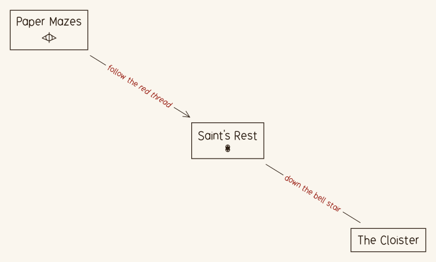

### `graph::parse(text)`

The Graph a .graph file's text writes, as content(name) reads a content/NAME.graph file. A line is a place, `Name`, `Name: glyph glyph` (its glyphs by name, from the drawing's glyphset) or `Name: glyphset "text"` (each of the text's characters a glyph of that glyphset, blanks left out: `Saint's Rest: thirteen_black_priests "4A0Ef"`), or a way, `A -> B` (one way) or `A -- B` (both ways), the arrow with a space either side, then `: text` if it has any; an indented line carries on the line above, # lines are comments, and blank lines are nothing. A way can name a place no line gives; places come in the order they're first named. Names can't hold a colon. Errors name the line: a place given two lines, a way from a place to itself, a line that's neither.

| argument | what it does | takes |
|---|---|---|
| `text` | The graph, a line at a time. | a string. |

### `graph::layout(graph, sizes), graph::layout(graph, sizes, options)`

A Graph laid out by forces, as graph_map lays out its map: the places' boxes pushed apart and the ways pulled to length, each way long enough for its text, each place's name, if it's given one, beside its box, then the best of four seeded starts kept and tidied, so nothing overlaps, and fitted to the box, which grows in proportion if the graph needs more room. Gives #{ points, size, edges, names }: each box's centre ([x, y]), the size used ([width, height]), each edge's #{ start, end, label, angle, pieces }: where its line leaves its first box and meets its second (gap short of each), the middle of its text, how far to turn the text (0 upright; otherwise the line's angle, folded so text reads left to right), and the line's pieces, [[x, y], [x, y]] each, broken round any text or name set over it; and each name's centre ([x, y], or () for a place without one). A name goes half a gap from its place's box, on whichever of eight sides (right, left, under, over, then the corners) is clearest of the lines, texts, boxes and other names. Ways joining the same two places are drawn side by side.

| argument | what it does | takes |
|---|---|---|
| `graph` | What to lay out. | a Graph. |
| `sizes` | Each place's box. | an array of [width, height], one for each node. |

| option | default | what it does | takes |
|---|---|---|---|
| `options.labels` | none | Each way's text's size; () for a way with none. | an array of [width, height] or (), one for each edge. |
| `options.names` | none | Each place's name's size, to set beside its box; () for a place without one. | an array of [width, height] or (), one for each node. |
| `options.label_place` | along | Where a way's text goes: along, turned to its line, which breaks for it; beside, above the line; upright, level across the line, which breaks round it. | along, beside or upright. |
| `options.gap` | 12 | The room kept between boxes, texts, names and lines; half of it between a box and its name. | a number of at least 0. |
| `options.width`, `options.height` | 1000 and 800 | The box to lay it out in, from (0, 0). | positive numbers. |
| `options.seed` | 0 | Which layout. | a whole number. |
| `options.iterations` | 300 | How many steps the forces take. | a whole number up to 5000. |

```rhai render=graph_layout
let g = graph::parse("A -> B: north\nB -> C: east\nC -- A: home");
let sizes = [[16, 16], [16, 16], [16, 16]];
let names = [[40, 30], [40, 30], [40, 30]];
let laid = graph::layout(g, sizes, #{ labels: [[50, 16], [40, 16], [50, 16]], names: names, width: 400, height: 240 });
for (p, k) in laid.points {
	page.add(new_circle(vec2(p[0], p[1]), 8), PEN);
	let at = vec2(laid.names[k][0], laid.names[k][1]);
	page.add(new_rectangle(at, names[k][0], names[k][1]), PEN);
	let name = write_line(g.nodes[k].name, vec2(0, 0), TEXT);
	page.add(name.translate_by(at - name.bounds().center));
}
for edge in laid.edges {
	for piece in edge.pieces {
		page.add(new_line(vec2(piece[0][0], piece[0][1]), vec2(piece[1][0], piece[1][1])), RED_PEN);
	}
	page.add(new_circle(vec2(edge.label[0], edge.label[1]), 4), RED_PEN);
}
```

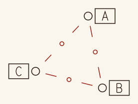

### `art::sketch(value)`

A value kind's default drawing as a parts map for canvas.add(parts, styles): each part a path (a StarChart's links and stars, a HuffmanCode's links and nodes, a Maze's corridors, a Graph's name boxes, glyphs, lines and arrows), plus labels, an array of #{ at, text } to write, and label_size, how big to write them, in the drawing's units.

| argument | what it does | takes |
|---|---|---|
| `value` | What to draw. | a value kind's data whose kind has a sketch. |

## Journals and Their Files

A journal is a directory: its manifest, journal.json; its entries, entries/NAME.rhai, each a script building a journal_entry of pages; and files of its own, each kind in a directory of its own: locks/, helpers/, layouts/, illustrations/, chains/ and lib/ (rhai files), styles/ and glyphsets/ (NAME.json), content/ (NAME.txt, a String; NAME.md, Markdown; NAME.json, Symbols: { base, text }, with strict: true or not, or { base, symbols }; or NAME.graph, a Graph), and images/ (NAME.png or NAME.jpg, pictures for image(name)). They stand in front of the built-in library's, webapp/library/, which has the same directories: a journal's file stands in for the library's of the same name. Each entry runs on its own, sharing the journal's files but not code with the other entries.

journal.json: the journal's manifest, a JSON object.

| key | default | what it does | takes |
|---|---|---|---|
| `version` | required | Which manifest format. | 1. |
| `title` | required | The journal's title. | a string. |
| `description` | none | What it is. | a string. |
| `entries` | required | Its entries, in order: entries/NAME.rhai each. | a non-empty array of names: letters, digits and underscores. |
| `bundled` | none | Library files an export copied in beside the journal's own, as paths from the journal (locks/huffman.rhai), so an import can drop them. | an array of strings. |

glyphsets/NAME.json: a glyphset, a JSON object. Glyph units span about -1 to 1, y down; a glyph scale is 2 of them.

| key | default | what it does | takes |
|---|---|---|---|
| `glyphs` | required | Each character's glyph (or each symbol's, by name): SVG path data, or an array of variants, one picked at random each time it's set. A cursive glyph's first stroke runs from where it's entered to where it's left; dots and crossbars come after. | an object of strings or arrays of strings. |
| `character_padding` | 0 | Room between glyphs' outlines, in glyph scales. | a number of at least 0. |
| `space_width` | 0.5 | A space's width, in glyph scales. | a positive number. |
| `fallback` | none | The glyphset to look in for characters this one hasn't. | a glyphset's name. |
| `glyph_padding` | none | Room some glyphs keep on top of character_padding, in glyph scales. | an object of glyphs to numbers of at least 0. |
| `joins` | none | Joins words up, as glyphset.joined says: enter and leave, the glyphs that join the glyph before and the glyph after; leave_high, those left high, after which a variant entered high is drawn; x_height and baseline, the heights a variant's entry is told high or low by, and between them the x-height how far apart glyphs join is measured in. | an object: enter, leave and leave_high (default none), strings of glyphs; x_height and baseline, glyph units, x_height less than baseline. |

### `text_style(name), text_style(name, options)`

A text style file's bundle, styles/NAME.json, the journal's or the library's: #{ style, type, paragraph, spans }, the style, type and paragraph whole (a map's settings over default_style(), no type and the default paragraph), and spans if it gives any. It's a role for typeset, and the settings map of any text call, which ignores spans unless it sets marked-up text.

| argument | what it does | takes |
|---|---|---|
| `name` | Which style file. | a style file's name without .json. |

| option | default | what it does | takes |
|---|---|---|---|
| `options` | the file's own | Its options: size, the glyph scale, which its glyph_position_jitter and baseline_wander follow, and color, its ink. | a map of size, a positive number, and color, a colour or a gradient, whole or as data (see Gradients), or image paint (see Images). |

### `content(name)`

A content file, content/NAME.txt, NAME.md, NAME.json or NAME.graph, the journal's or the library's: a .graph file's Graph, as graph::parse reads it; a .txt or .md file's text, without the newline ending the file (markdown(content(name)) sets marked-up text), or a .json file's symbols: its text made to fit its base, as symbols(base, text, #{ lenient: true }) gives them, or with strict: true in the file, read as symbols(base, text) reads it, text the base can't write being an error; or the symbols the file holds, { base, symbols }.

| argument | what it does | takes |
|---|---|---|
| `name` | Which content file; there mustn't be more than one of that name. | a content file's name without its extension. |

Any script, an entry or a lock, layout, illustration or chain file, imports shared functions from lib/: import "lib/NAME" as NAME; then NAME::f(x) calls lib/NAME.rhai's function f. A lib function runs in the engine of the script importing it: a lock file's lib functions can't draw.

## Lock, Illustration, Layout and Style Files

### Lock files

A lock file, locks/TYPE.rhai, defines functions that lock and unlock run, and can call rhai's standard library, the functions below, new_maze and value kinds' functions (huffman::code, stars::layout, stars::split), but nothing unseeded and nothing to draw with; see the library's locks/README.md. o, in each, is the lock's options, checked against their types first.

#### `fn options()`

Gives each option's type: #{ NAME: type }, a type being one of the option types below.

#### `fn check(o)`

Optional: throws to reject options, for what their types can't say, such as a base that must be even. Runs at lock.add.

| argument | what it does | takes |
|---|---|---|
| `o` | The options. | a map of option names to values. |

#### `fn inputs(o), fn outputs(o)`

Give the lock's values and their types: #{ NAME: type }. A value that is both an input and an output, such as a key, is passed through.

| argument | what it does | takes |
|---|---|---|
| `o` | The options. | a map. |

#### `fn lock(o, inputs)`

Gives every output: #{ NAME: value }, each checked against its type.

| argument | what it does | takes |
|---|---|---|
| `o` | The options. | a map. |
| `inputs` | The input values. | a map of input names to values: symbols as arrays of whole numbers, value kinds' data as maps. |

#### `fn unlock(o, outputs)`

Gives the inputs it recovers: #{ NAME: value }; passed-through ones needn't be.

| argument | what it does | takes |
|---|---|---|
| `o` | The options. | a map. |
| `outputs` | The output values. | a map of output names to values. |

#### `fn examples()`

Optional: test cases, run by --check-locks and cargo test, each locked and unlocked and needing its inputs back. Gives an array of #{ options, inputs, outputs, error }.

| option | default | what it does | takes |
|---|---|---|---|
| `options` | required | The options. | a map. |
| `inputs` | required | The inputs. | a map of names to symbols(base, text) and the like. |
| `outputs` | not checked | What locking must give. | a map of names to values. |
| `error` | none | Text the example must fail with, instead of locking. | a string. |

#### `fn chain(o)`

In place of inputs, outputs, lock and unlock: a composite lock's chain, #{ locks, connect, fixed, inputs, outputs }; composite lock files are written by hand.

| argument | what it does | takes |
|---|---|---|
| `o` | The options. | a map. |

| option | default | what it does | takes |
|---|---|---|---|
| `locks` | required | Each part. | a map of ids to #{ type, options }, options able to use o. |
| `connect` | required | The wiring. | an array of [output, input] pairs, as lock.connect takes them. |
| `fixed` | required | Values for inputs, as lock.set_input sets them. | a map of ID.NAME to values. |
| `inputs`, `outputs` | required | The composite's own names for the chain's open ports. | a map of names to ID.NAME. |

### Chain files

A chain file, chains/NAME.rhai, is a chain of lock types and the illustrations drawing its values, which chain(name) builds; the web editor's lock editor writes them. It runs in the lock files' engine, so it writes values as they do (symbols(27, TEXT) as an array); see the library's chains/README.md.

#### `fn options() in a chain file`

Optional: the chain's options, as a lock file's options() declares them, which chain(name, options) gives.

#### `fn chain(o) in a chain file`

The chain: #{ sources, locks, connect, fixed, illustrations }.

| argument | what it does | takes |
|---|---|---|
| `o` | The options. | a map. |

| option | default | what it does | takes |
|---|---|---|---|
| `sources` | none | Journal files it draws on, as lock.source adds them; connect and illustrations' inputs take ID.value. | a map of ids to #{ type, name, options, base }: type content, style, glyphset or layout. |
| `locks` | required | Each lock. | a map of ids to #{ type, options }, options able to use o. |
| `connect` | none | The wiring. | an array of [output, input] pairs, as lock.connect takes them. |
| `fixed` | none | Values for inputs, as lock.set_input sets them. | a map of ID.NAME to values. |
| `illustrations` | none | Illustrations attached, as lock.attach attaches them. | a map of ids to #{ type, options, inputs }: options able to use o, inputs a map of each illustration input to the ID.NAME it draws. |

#### `fn layout() in a chain file`

Optional: where the lock editor draws each lock and illustration: #{ ID: [x, y] }.

#### `fn example() in a chain file`

Optional: a value for each of the chain's open inputs, #{ ID.NAME: value }, run with its default options by --check-locks and cargo test, which lock and unlock it and need the inputs back; the lock editor's test case.

#### `integer(), number(), string(), bool(), array()`

Option types, in options(): an option of that type, required unless given a default. An integer is fine for a number.

| option | default | what it does | takes |
|---|---|---|---|
| `default` | none, so it's required | What the option is when lock.add leaves it out. | a value of the type. |

#### `one_of(choices), one_of(choices, default)`

An option type: one of some values.

| argument | what it does | takes |
|---|---|---|
| `choices` | The values it can be. | a non-empty array. |

| option | default | what it does | takes |
|---|---|---|---|
| `default` | none, so it's required | What it is when left out. | one of the choices. |

#### `symbol_type(base)`

The type of symbols in a base, such as Base27Symbol: an array of whole numbers from 0 to base - 1. Other types are a value kind's (Graph, HuffmanCode, Maze, StarChart: values checked against the kind's shape), String, Any (which matches every type) or a name of the file's own.

| argument | what it does | takes |
|---|---|---|
| `base` | The base. | a whole number from 2 to 27. |

#### `symbols(base, text), symbols(base, text, options) in lock files`

Text as an array of symbols: symbols(27, HI) is [8, 9].

| argument | what it does | takes |
|---|---|---|
| `base` | The base, as symbols takes it in journals. | a whole number from 2 to 27. |
| `text` | The text. | a string of the base's symbols. |

| option | default | what it does | takes |
|---|---|---|---|
| `options.lenient` | false | As in journals: any text made to fit. | true or false. |

#### `symbol_text(base, symbols)`

Symbols back as text: symbol_text(27, [8, 9]) is HI.

| argument | what it does | takes |
|---|---|---|
| `base` | The base. | a whole number from 2 to 27. |
| `symbols` | The symbols. | an array of whole numbers from 0 to base - 1. |

#### `new_random(seed)`

A generator for lock files, the only randomness they have: the same seed gives the same numbers every run. Copies share it, so a helper handed one moves it on for its caller too.

| argument | what it does | takes |
|---|---|---|
| `seed` | Which numbers. | a whole number. |

#### `random.next()`

A number from 0 up to 1.

#### `random.range(low, high)`

A number from low up to high.

| argument | what it does | takes |
|---|---|---|
| `low`, `high` | The range. | numbers. |

#### `random.pick(items)`

One of the items.

| argument | what it does | takes |
|---|---|---|
| `items` | What to pick from. | a non-empty array. |

### Illustration files

An illustration file, illustrations/TYPE.rhai, runs in the journal's engine, so it can call everything a journal can, and draws lock values as canvases; see the library's illustrations/README.md. o, in each, is its options: its defaults with what lock.attach, or illustration(name, options) and illustration.run, gave over them.

#### `fn options()`

Optional, in an illustration file: its options and their defaults, #{ NAME: value }; lock.attach, illustration(name, options) and illustration.run can give only these, each like its default, a colour option taking a colour or a gradient (see Gradients).

#### `fn inputs(o)`

In an illustration file: the values it draws and their types, #{ NAME: type }, as a lock file's inputs are written (Base27Symbol, Maze, StarChart, String, Any...), or TextStyle, Glyphset or Layout for what a chain's style, glyphset or layout source gives. A TextStyle input comes whole, #{ style, type, paragraph } (and spans, if it has any), as text_style gives it, whatever map it was given as.

| argument | what it does | takes |
|---|---|---|
| `o` | The options. | a map. |

#### `fn render(o, i)`

In an illustration file: a canvas, or an array of canvases, drawing the values.

| argument | what it does | takes |
|---|---|---|
| `o` | The options. | a map. |
| `i` | The values, as lock files see them: symbols as arrays of whole numbers, value kinds' data as maps. | a map of its input names to values. |

#### `fn fallbacks(o)`

Optional, in an illustration file: what inputs nothing's wired to draw with, #{ NAME: value }, each NAME one of its inputs; an input without one must be wired. A TextStyle input wired a bundle missing a key, or a type missing a glyphset, size, gap, space width, skew or joining, takes the fallback's: a pen-only style keeps the fallback's glyphs and size. The library's illustrations take each kind of text they write as a TextStyle input, drawn whole (its pen and hand, its glyphs at its size, its paragraph), with fallbacks made from their options, a ROLE_size option giving each one's size.

| argument | what it does | takes |
|---|---|---|
| `o` | The options. | a map. |

#### `fn example()`

Optional, in an illustration file: values to draw it with when nothing's connected, as the web editor previews it and cargo test checks it: #{ NAME: value }.

### Layout files

A layout file, layouts/NAME.rhai, runs in the journal's engine, so it can call everything a journal can; see the library's layouts/README.md.

#### `fn options()`

Optional, in a layout file: its options and their defaults, #{ NAME: value }; layout(name, options) can give only these, each like its default, a colour option taking a colour or a gradient (see Gradients).

#### `fn page(n, info)`

Gives page n's tree of boxes.

| argument | what it does | takes |
|---|---|---|
| `n` | Which page, from 0. | a whole number. |
| `info` | What's left to set: flows maps each flow's name to how many characters of it are left, art lists the art's names, width and height are the page's size, and options are the layout's options. | a map, #{ flows, art, width, height, options }. |

#### `fn page_size(o), fn page_size()`

Optional: the page's size, #{ width, height }, positive numbers, given the options. typeset's width and height take its place.

#### `fn example()`

Optional, in a layout file: what to typeset to preview it, as the web editor does and cargo test checks: typeset's options, #{ flows, roles, art, ... }.

### Style files

styles/NAME.json: a text style, a JSON object of every setting a style, type and paragraph have, as the web editor's style form sets them, every key optional; text_style(name) gives what it describes. Styles were once scripts, styles/NAME.rhai: the web editor converts those a file can say all of when it loads a journal, and says what's stopping the others; nothing else reads them.

| key | default | what it does | takes |
|---|---|---|---|
| `description` | none | What it's for, as the web editor lists it. | a string. |
| `example` | lorem ipsum, content("lorem") | The text to preview it with, as the web editor does and cargo test checks. | a string. |
| `color` | black | Its ink, and the color option's default. | a colour, or a gradient as data: { colors, ...new_gradient's options } (see Gradients). |
| `brush`, `brush_size`, `min_pressure`, `max_pressure`, `pressure_profile`, `pressure_wander`, `pressure_wander_length`, `pool`, `pool_depth`, `color_jitter` | default_style()'s | Its pen. | as new_brush_style takes them. |
| `passes`, `pass_end_jitter`, `stroke_point_jitter`, `glyph_rotation_jitter`, `glyph_scale_jitter` | default_style()'s | Its hand. | as new_handwriting_style takes them. |
| `glyph_position_jitter`, `baseline_wander` | 0 | Its hand, in glyph scales here, not canvas units, wherever they're written, a span's and a line's too: they follow its size, and need one. | numbers of at least 0; glyph_position_jitter also [across, down]. |
| `glyphset` | none | The glyphs it's set in. | a glyphset's name. |
| `size` | none | Its glyph scale, and the size option's default. | a positive number. |
| `glyph_scale_factor`, `glyph_outline_gap`, `glyph_tracking`, `space_width`, `skew`, `italic`, `joined` | those of a type_style | Its type. | as new_type_style takes them. |
| `underline`, `strike` | none | Lines under and through it. | as new_type_style takes them, a line's style a map of settings, its colour a colour or a gradient as data. |
| `line_height`, `paragraph_gap`, `indent`, `align`, `valign`, `fit`, `layout`, `angle`, `split_words`, `split_padding`, `break_words`, `clearance`, `line_start_jitter`, `line_gap_jitter`, `overhang` | those of a paragraph_style | Its paragraph. | as new_paragraph_style takes them. |
| `spans` | none | Named spans, as a role has them: each one's style and type are maps of settings, colours and gradients as above and glyphsets by name. | an object of span names to their style and type. |

## The Library

The built-in library, webapp/library/, holds what any journal can use; a journal's own file of the same name stands in for one (see Journals and Their Files). Its files, by directory:

| glyphset | what it writes |
|---|---|
| `plain` | Easy-reading letters, capitals, digits and punctuation: the one to label and write body text in. |
| `loche_upper` | Loche capitals, for headings; `loche_lower` is its small letters, falling back on the capitals. |
| `copper` | Copperplate capitals and small letters, with variants picked at random, for headings; it falls back on `loche_upper`. `debug_copper_lower` is a few small letters of it, for testing. |
| `ayan` | A cursive traced from the US Declaration's hand, its words joined up; it falls back on `plain`. |
| `sharp_lower` | Sharp small letters. |
| `nivelia` | Traced from Nivelia's letter; it falls back on `loche_upper` for the capitals she never wrote. |
| `lang` | Capitals, small letters and punctuation in a hand of its own. |
| `eldritch` | Strange letters, one for each of a to z. |
| `balanced_ternary` | A glyph for each three-trit balanced-ternary number, -13 to 13: glyph(balanced_ternary(n)) draws n. |
| `symbols` | Marks named for what they are (basic_eye, archangel_0 to archangel_3, ploughdiem...): glyphset("symbols").characters() names them. |
| `the_four_divine` | Base 4 digits, written a, i, l and v. |
| `thirteen_black_priests` | Base 13 digits, written 0 to 8, A, E, f and s. |

| file | what it is |
|---|---|
| `locks/doublering`, `keyed_doublering`, `huffman`, `huffman_apply`, `huffman_encode`, `maze_lock`, `shift_cipher`, `shift_vigenere`, `star_chart`, `substitution_cipher`, `vigenere_cipher` | Lock types (see Locks for each's options). |
| `helpers/merge_alpha`, `split_symbols`, `string_to_symbols`, `symbols_to_string` | Helper types, lock files that join, cut and convert values between locks. |
| `illustrations/eye`, `graph_map`, `joined_symbol_ring`, `maze_glyphs`, `rearranged_symbol_ring`, `star_pages`, `styled_text`, `symbol_ring`, `trit_message` | Illustrations (see Value Kinds for what each draws). |
| `chains/raven_sky` | A chain: a message locked with a text's Huffman code, and the code drawn as a sky of named stars cut into constellations, a page each: the pages are the key. |
| `layouts/bordered_title` | A title page: the title, a flourish and the credits centred in a ruled frame, inside a border of ornamental bands. |
| `layouts/captioned_figure` | A figure filling the page, with its caption centred beneath it. |
| `layouts/two_column_article` | An article in two columns, opening with a heading, a drop cap and a captioned illustration, the body running on over as many pages as it takes. |
| `styles/plain_hand` | Easy-reading text in plain, written with an ink pen by a hand a little unsteady. |
| `styles/copper_heading` | Headings in copper, centred, with a broad calligraphy nib at a constant pressure; strong text gone over twice. |
| `content/lorem` | Lorem ipsum, a paragraph of it. |
| `lib/huffman` | Reading and writing text with a Huffman code given as its tree. |
| `lib/names` | Names for stars and constellations, made from syllables. |
| `lib/permutations` | Permutations of a base's symbols, as tables, for the substitution and doublering locks. |
| `lib/symbol_rings` | Rings of a base's symbols and the walks round them, for the symbol ring illustrations; arrowhead(tip, direction, size) draws an arrowhead. |

## Building

### `journalbuild NAME [flags]`

Runs a journal's entries, each on its own, and renders their pages, an entry's into a directory named for it. An entry that fails doesn't stop the others rendering: the failures, and why, are listed at the end, and the exit status is 1.

| argument | what it does | takes |
|---|---|---|
| `NAME` | Which journal. | a directory with a journal.json in the journals directories (the first that has it), or a journal directory's path (anything with a slash). |

| option | default | what it does | takes |
|---|---|---|---|
| `--entry E,...` | every entry, in order | Builds only these entries. | entry names, separated by commas, as --entry letter_1. |
| `--page P,...` | every page | Renders only these pages of each entry built; other pages' existing output is kept. | page indices (from 0) or names, separated by commas, as --page 0,maze. |
| `--scale S` | 1 | Scales output images, brushes included; Darkly work scales with output size, so 0.25 renders much faster. | a positive number. |
| `--supersample K` | 3 | Renders Darkly output K times larger and filters it back down, smoothing thin, aliased strokes; memory grows with K squared. Stops short of K where a render would pass 8192 pixels across or down. | a number of at least 1; 1 turns it off. |
| `--svg` | off | Renders each canvas as an SVG, PAGE_CANVAS.svg, and that SVG as a PNG, on the CPU, instead of with Darkly: it needs no GPU, and so takes no --parchment, --pdf, --stitch or --supersample. | a flag. |
| `--strict-glyphs` | off | Fails an entry before rendering it if any of its characters had no glyph, rather than drawing it as X and warning. | a flag. |
| `--parchment` | off | Renders each page as one image, darkly_PAGE.png, its canvases layered on procedural parchment; light inks are drawn dark, and ink soaks in a little unevenly, very slightly thinner in places. | a flag. |
| `--pdf` | off | Puts each entry's pages in one PDF, ENTRY.pdf, a page each at 150 canvas units to the inch, rather than writing images; on parchment with --parchment; with --stitch N, N pages side by side to a PDF page. | a flag. |
| `--stitch N` | off | Also lays every N pages side by side, in order, tops level, named for the pages they hold: page_0 to page_5 as darkly_page_0-5.png (the last may have fewer; a page left alone is not stitched). Pages are rendered one image each, as with --parchment, on parchment with it. With --pdf, the PDF's pages are the stitches instead, a page left alone at the end a page of its own. | a whole number of at least 1. |
| `--journals-dir DIR` | the repository's journals/, then webapp/journals/ (the web editor's built-in journals) | Where journals are, in place of the default's two. | a directory. |
| `--library DIR` | the repository's webapp/library/ | The built-in library the journal's files stand in front of. | a directory. |
| `--output-dir DIR` | NAME_output in the current directory | Where renders go, a directory for each entry. The default's entry directories are emptied first, except with --page; in a given directory, earlier .png, .svg and .pdf renders in an entry's directory are cleared first, except with --page. | a directory. |

### `journalbuild --check-locks [NAME] [--journals-dir DIR] [--library DIR]`

Runs every lock file's examples, and every chain file's, through lock and unlock instead of building a journal: the library's, or with NAME, the journal's own.

| option | default | what it does | takes |
|---|---|---|---|
| `NAME` | none: the library's | Which journal's lock and chain files. | a journal, as journalbuild NAME takes it. |
| `--journals-dir DIR`, `--library DIR` | the repository's | As for journalbuild NAME. | a directory. |

### `journalbuild --check-gpu`

Checks that Darkly can render here, that there's a GPU wgpu can use, instead of building a journal. Fails if there isn't one; --svg renders still work without one.
